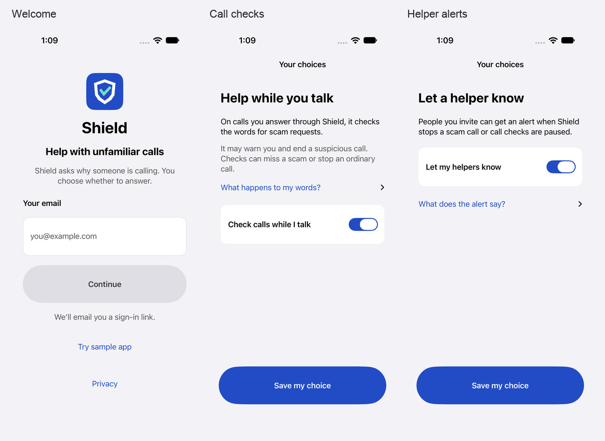
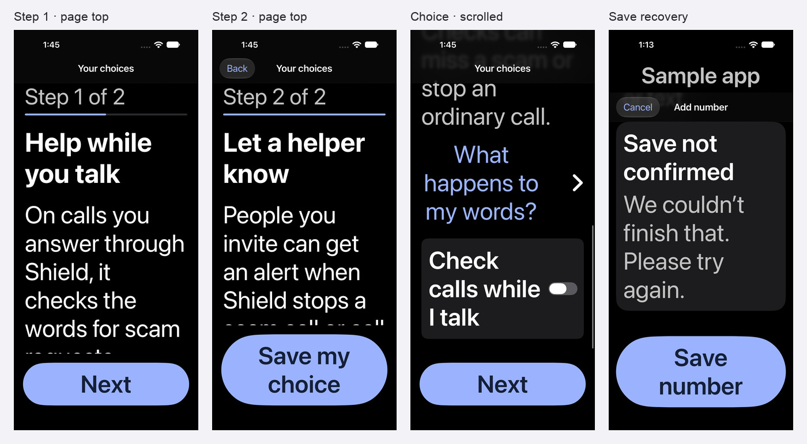

# iPhone usability review for older adults

Started October 12, 2026. The design bar is an 80-year-old completing each task with readable text, familiar controls, a clear next step, and a way to recover. This record separates source changes, simulator evidence, and work that needs a person or a real phone.

## October 14 — selected identity and audit performance

The owner-selected rounded, integrated S-shield now supplies the app icon, sign-in mark and launch mark. The four approved source PNGs and their original generation/selection manifest are tracked in `artwork/identity/`. AppIcon and ShieldMark match the approved 1024-pixel source byte-for-byte; LaunchMark applies the existing continuous-corner mask. The generator verifies the source hash, preserves the semantic colors and removes its temporary Swift cache. The sign-in wordmark remains native serif text. The icon was inspected on the simulator home screen and in sign-in; the rounded launch asset was also inspected.

The unfinished audit optimization replaced delayed existence waits with an immediate check, reused screenshots for attachments and file exports, and stopped attaching the full accessibility tree for every issue. The complete tree is still attached once per screen, every issue is still reported, and the 0.8-second audit settle remains: removing it lost associated-element attribution. The sign-in tests now wait for the keyboard and the actual Send/Go key, verify the entered email, and refocus once if a cold simulator exposes a keyboard below the screen. All three corrected sign-in tests passed, including standard and largest text keyboard recovery.

The earlier single-simulator logs from Claude show SeniorDesign's five tests improving from 546.7 to 487.6 seconds and SeniorPolish's 22 tests from 632.1 to 542.3 seconds, all passing. The accessibility suite itself stayed near 291 seconds; most of that cost is in launches and Apple's audit. These are observed, machine-dependent timings from the earlier run, not a controlled benchmark of this final revision. Its two additional keyboard failures were the remaining functional regressions addressed above.

Use the [focused audit command](../ios/README.md#run-focused-ui-audits) with one simulator, the existing build cache and `-collect-test-diagnostics never`. This avoids the system-diagnostic collection that stalled Claude's completed tests, while retaining failure records, screenshots, trees and issue attachments. The final sign-in result bundle closed immediately after the tests (1.8 MB). Typecheck, 232 unit tests, the backend build and 159 Firestore emulator tests passed. Initial sandboxed checks could not bind localhost; the successful runs used local-server access.

Final iPhone 18 Pro / iOS 27 verification: the two invitation-removal tests passed. SeniorAccessibility ran in 327.9 seconds, with four passing tests, eight failing tests and one skipped external-fixture test; it recorded 35 raw findings. The three selected Redesign audits recorded four findings. The failing test names match the earlier runs exactly; differing counts of repeated native diagnostics are not treated as fixes. This final audit run was slower than the earlier 291-second run, so no speedup of Apple's accessibility engine is claimed. The combined 18-test run finished in 407.9 seconds, and result collection completed about half a second later instead of stalling. All five targeted functional checks (three sign-in, two invitation removal) passed.

Local evidence is under `artifacts/brand/`: `sign-in-final.log`, `audit-final.log`, `audit-summary.json`, `audit-evidence/`, `earlier-ui-timings.json` and the two verified repository-check logs. Captures include `shield-in-app.png` and `shield-home-icon.png`. The bulky audit result bundle and generated recordings were removed after retaining its summary, screenshots, accessibility trees and issue text; no extra simulator or DerivedData checkout was created.

This work changes source and simulator builds only. It does not deploy the backend, install on the owner's phone, change forwarding or provide new real-call evidence.

## Labeled bottlenecks and corrections

The entries below describe observed source or simulator problems. “Implemented” means the source fix exists; verification is recorded separately below.

October 14, 2026: invitation creation and acceptance were removed from the app. S42, S43, S77, S79 and S87 no longer apply, and S41 now covers only the helper list and Stop sharing.

| ID | Bottleneck | Change | State |
| --- | --- | --- | --- |
| S01 | Welcome assumes the person already knows what Shield does. | Explain unfamiliar-call checks and the person’s choice before asking for an email. | Implemented |
| S02 | Email field loses its visible name once text is entered. | Keep a visible field label and an example address. | Implemented |
| S03 | Email-link instructions assume someone knows where to find the link. | Name the email app, this iPhone, and the Shield sign-in link; retain address, spam advice, resend and change-email actions. | Implemented |
| S04 | Cold-launch sign-in does not explain which email to enter. | Ask for the same email that received the link. | Implemented |
| S05 | Number-pad sign-in has no reliable keyboard dismissal. | Add a native Done control. | Implemented |
| S06 | Sent-email and error feedback can be missed by a screen-reader user. | Move accessibility focus to the relevant status. | Implemented |
| S07 | Protection choice appears before its explanation. | Explain checks, possible disconnection and mistakes before the switch. | Implemented |
| S08 | Two onboarding choices have no progress and can inherit the prior scroll position. | Show two-step progress, scroll to the new heading, and move accessibility focus. | Implemented |
| S09 | Helper-alert explanation lists too much before the choice. | Keep the main purpose visible and place alert contents and repeated-attempt details in the disclosure. | Implemented |
| S10 | Setup’s five-phase counter repeats the same step across different tasks. | Count the ten actual setup screens, excluding the introduction and separate disconnection flow. | Implemented |
| S11 | Setup Back is an unlabeled arrow for sighted users. | Show Back and retain the explicit Previous step accessibility name. | Implemented |
| S12 | Setup provides no obvious way to leave and resume. | Add Close; retain saved progress and all carrier/probe confirmations. | Implemented |
| S13 | Setup’s options are only an ellipsis. | Show Options with its Setup options accessibility name. | Implemented |
| S14 | Consent uses numbered circles for information that is not a sequence of actions. | Use clear headings and short explanations; retain provider, capture, retention and mistake disclosures. | Implemented |
| S15 | Copied-code disclosure and repeated connection labels interrupt the instructions. | Lead with copy status and the Phone instructions; move the optional code below them. | Implemented |
| S16 | Setup instruction numerals use a fixed circle that clips at large text sizes. | Scale the numeral container with the text. | Implemented |
| S17 | Disconnection repeats sub-phase eyebrow labels above task headings. | Remove redundant labels; retain the overall seven-step progress and individual confirmations. | Implemented |
| S18 | A long disconnection confirmation consumes the large-text action area. | Use “I selected Never” next to the exact Screen Unknown Callers instructions. | Implemented |
| S19 | Call outcome and number clip together at large text sizes. | Stack title/time and outcome/number at larger text sizes. | Implemented |
| S20 | Invisible unread dots waste width; removed messages can still look new. | Reserve the dot for an actual new message and use words at accessibility sizes. | Implemented |
| S21 | Large-text call filter has a redundant heading and oversized menu value. | Give the menu one descriptive label, such as All calls or Stopped calls. | Implemented |
| S22 | Large-text person toolbar competes with the screen title and can shorten names. | Move the full person context and Change person action into the scrollable page. | Implemented |
| S23 | Sample marker adds an oversized decorative icon at large text sizes. | Keep the persistent readable marker without the decorative icon. | Implemented |
| S24 | Message kind, unread/kept status and date compete on one line. | Stack metadata at larger text sizes. | Implemented |
| S25 | The sample inbox repeats its purpose above an already clear picker. | Remove the extra introduction; retain the sample marker and All/Kept choice. | Implemented |
| S26 | Home can show a blank recent-calls section when all recent records are messages. | Decide emptiness from the actual calls displayed. | Implemented |
| S27 | Home refresh failure can leave old activity without a visible recovery action. | Show an out-of-date explanation and retry alongside retained activity. | Implemented |
| S28 | Several lists can leave final rows too close to the tab bar. | Add shared bottom content space, while retaining native safe areas. | Implemented |
| S29 | Failed setup load can leave a permanent loading view. | Show a contextual error and Try again; distinguish loading from failure. | Implemented |
| S30 | Saved numbers can show No numbers while loading or after failure. | Separate loading, failure and empty states; add a visible empty-state Add action. | Implemented |
| S31 | Calling a saved number competes with its name/number at large text sizes. | Give the name, full number and actions their own space. | Implemented |
| S32 | Removing saved numbers depends on discovering a swipe. | Add a visible Remove action and confirmation. | Implemented |
| S33 | Adding a number uses disappearing labels, weak area-code guidance and a small toolbar Save. | Use persistent labels, area-code guidance, keyboard dismissal and a full-width Save number action. | Implemented |
| S34 | Blocked-number load failure has no local retry and its empty overlay can obscure help. | Put loading, failure and empty states inside the list; keep About blocked numbers reachable. | Implemented |
| S35 | Allow calls again can be difficult to tap or distinguish by number. | Increase its labeled touch area and supply a number-specific accessibility name. | Implemented |
| S36 | Quiet hours shows disabled defaults after failure with no recovery. | Separate loading/error/sample states from the actual saved choice and expose retry. | Implemented |
| S37 | Quiet hours save status can be mistaken for an automatic save. | Distinguish changes from saved hours, keep a visible Save action and explain Central time. | Implemented |
| S38 | Alert permission requests can do nothing once iOS permission is denied. | Show current alert state and a direct settings recovery path; do the same for denied Contacts access. | Implemented |
| S39 | Helper-alert setting can silently appear off after a failed read. | Distinguish loading, unavailable and error states; provide retry. | Implemented |
| S40 | Sharing can say No one has access while the request is still loading or failed. | Separate those states and retain existing grants during recovery. | Implemented |
| S41 | Sharing has a disappearing name label and a low-emphasis invitation action. | Keep the helper’s name labeled, explain scope and make the invitation action clear. | Implemented |
| S42 | New invitation can appear below the current reading position. | Scroll and move accessibility focus to the invitation; explain one-use/two-day validity. | Implemented |
| S43 | Invitation acceptance requires knowing the edit-menu paste gesture. | Add native Paste and a visible Join action, keyboard dismissal and local error feedback. | Implemented |
| S44 | Shared-contact loading/failure/search-empty states look like a blank list. | Explain each state and provide recovery. | Implemented |
| S45 | Contact removal is swipe-only and recovery is not exposed. | Add visible Remove and per-contact Add back to Contacts, keeping the existing confirmation and local restore logic. | Implemented |
| S46 | People’s message-sharing scope still uses the older voicemail-only wording. | Use Calls and messages and expose selection as a screen-reader trait. | Implemented |
| S47 | Text-check instructions repeat the task above its controls. | Let the editor, Paste and Choose picture identify the task; retain privacy/consent guidance. | Implemented |
| S48 | Picture selection is a small, vague action; errors can appear below the reading position. | Use Choose picture with a large target; scroll/focus error feedback. | Implemented |
| S49 | Message playback only supports stop/restart. | Add pause/resume, elapsed progress and Start over; retain stop on leaving/backgrounding. | Implemented |
| S50 | A person cannot tell what to try if message playback is quiet. | Add optional volume-button guidance. | Implemented |
| S51 | Call-detail refresh failure has only a generic global alert. | Keep the record and show a contextual retry. | Implemented |
| S52 | Repeated delete taps can submit the same message deletion again. | Show deleting state and guard duplicate requests. | Implemented |
| S53 | Empty-account Sign out can be triggered accidentally. | Confirm sign-out. | Implemented |
| S54 | Privacy uses a small, visually inconsistent text-only row. | Use the same roomy named action row as neighboring settings. | Implemented |
| S55 | Tapping the middle of a switch’s large label can miss its small active switch. | Make the full labeled row tappable while retaining native switch appearance and accessibility semantics. | Verified in both-choice and quiet-hour journeys |
| S56 | Native toolbar text scaling can keep the person picker visible after the page moves person context into the list. | Decide toolbar visibility in the parent page, outside the toolbar’s capped text environment. | Verified in the large-text person-switching journey |
| S57 | Repeated choice screens can retain a scrolled position after Next or Back. | Reset the scroll container when the question changes and retain the unsaved switch selection. | Verified in the large-text two-choice journey |
| S58 | A new-message dot relies on color when the person requests color-independent cues. | Show New message in words when Differentiate Without Color is active. | Implemented |
| S59 | Message detail repeats a summary heading and a large date block before the message. | Lead with purpose and summary; keep the date in More about this call. | Verified in the largest-text message journey |
| S60 | An incomplete email such as `name@` can enable submission and fail without useful guidance. | Validate basic address structure, explain the missing part and preserve the address after failure. | Verified on iPhone 17e |
| S61 | Editing a partly entered address/number requires precise caret placement or a selection gesture. | Add a named, large Clear action while editing, so the person can replace it directly. | Verified on iPhone 17e |
| S62 | Input fields can clip their text bounds and hide long values at large sizes. | Use growing native fields with persistent labels and readable editing space. | Native welcome/add-number/sharing clipping reports cleared |
| S63 | A spoken raw email address lacks context. | Announce Email sent to before the address; keep the visible address once. | Native sent-email description audit passed |
| S64 | Saving protection/helper-alert switches offers little feedback and may leave a stale setting after a failed write. | Show saving progress, reread after failure and describe an unread choice as unknown. | Implemented |
| S65 | A paused or finished call test offers Set up my phone, which suggests repeating carrier setup. | Name Resume call checks or Phone options and take these states to the settings menu. | Implemented |
| S66 | Pausing a pilot session does not explain the effect on incoming calls before changing it. | Confirm pause/resume with the voicemail and forwarding effect; hide it during incomplete setup. | Implemented |
| S67 | A message still being prepared has no direct refresh action. | Explain that the person can return later and offer Check again. | Implemented |
| S68 | Playback failures can appear below the current reading position. | Present a focused playback alert with Try again and Cancel. | Implemented |
| S69 | Audio-route changes run on the UI thread, and stale work can stop/restart newer audio. | Serialize route changes in an isolated audio actor and use request/session identities to ignore stale work. | Lifecycle journeys passed; a platform audio warning remains recorded below |
| S70 | A connected call ended by Shield can be described as never reaching the person. | Explain that Shield ended the call after the person answered when acceptance is recorded. | Implemented |
| S71 | Saved notices are called Voicemail in Calls but Saved notice in Messages. | Use the message’s kind consistently. | Implemented |
| S72 | The person cannot read privacy information before entering an email. | Add a readable Privacy link to sign-in. | Implemented |
| S73 | Paste assumes the person knows how to copy a message. | Offer concise, optional copying instructions beside the text-check workflow. | Implemented |
| S74 | Provisional iPhone permissions can be called alerts on without explaining silent delivery. | Label quiet alerts explicitly and offer the notification-settings path. | Implemented |
| S75 | Decorative row icons take valuable reading width at the largest text sizes. | Keep the full row labels and omit decorative icons at accessibility sizes. | Implemented after visual review |
| S76 | Phone setup’s extra subtitle repeats the destination and breaks words over many lines. | Use the clear Phone setup label alone. | Implemented after visual review |
| S77 | A long invitation code dominates the screen and can appear visually hyphenated. | Lead with Share invitation; put the complete selectable code in See invitation code. | Implemented after configured-screen review |
| S78 | An already checked pilot phone is still offered Set up my phone with a repeated introduction. | Name Open phone setup or Finish disconnecting from the actual state; remove the repeated explanation. | Implemented after configured-screen review |
| S79 | An expired invitation’s error can be below the screen at large text. | Scroll to the error, move accessibility focus there and clear stale feedback when the code changes. | Verified in largest-text recovery journey |
| S80 | A failed phone-setup operation can leave the next-action area visible while its recovery message is off-screen. | Scroll/focus the step error and retain the current step and explicit confirmation requirements. | Verified in sound-check and largest-text Contacts failure journeys |
| S81 | A number-save failure can be below the form while Save stays visible. | Scroll/focus the failure, retain entered fields and clear stale feedback when the fields change. | Verified in normal and largest-text recovery journeys |
| S82 | A quiet-hours save failure can appear below large hour pickers. | Scroll/focus the error and retain the unsaved choice until a successful save. | Verified in normal and largest-text recovery journeys |
| S83 | A large error icon crowds the recovery words at accessibility text sizes. | Keep the error heading and details; omit its decorative symbol at those sizes. | Implemented after recovery screenshot review |
| S84 | Allow calls again has a raised-hand symbol suggesting blocking. | Use the action’s words without the conflicting symbol. | Native blocked-button clipping report cleared |
| S85 | Contact removal labels have a narrow apparent action area. | Expand the button label and hit shape across the row, retaining confirmation. | Implemented; native unassociated hit-area diagnostics remain |
| S86 | The fixed Save button crowds growing fields when the keyboard is open; Done can leave a native editor active. | Show Save after editing, keep Done visible, and resign the native editor as well as clearing SwiftUI focus. | Normal and largest-text full editing journeys passed on both simulator sizes |
| S87 | Copying the whole shared invitation, including a trailing email signature, pastes prose into the code field. | Extract exactly one unique standalone service-format token, preserve ambiguous input and raw codes, and let the server validate access. | Native Paste journeys passed with and without a signature |
| S88 | Home’s collapsed title can sit over the blue panel; forcing the bar visible hides its large title. | Use automatic native visibility with a matching grouped background and explicit large-title mode. | Rest/scrolled pixels verified; collapsed-title contrast diagnostic cleared |
| S89 | Retrying an immediate save failure with the same wording can skip scrolling/focus feedback. | Track each failed attempt, so unchanged error wording still receives visible recovery feedback. | Repeated-failure largest-text journey passed |
| S90 | A generic failure says something didn’t load even when the person was saving. | Use action-neutral failure wording alongside each task’s contextual notice. | Implemented |
| S91 | The setup Save label repeats Contacts and consumes extra vertical space at the largest text size. | Use Save Shield; retain the task heading and permission explanation. | Implemented |
| S92 | A failed response can incorrectly say a write never happened, including a contact already saved on the phone. | Say the save is unconfirmed, explain known iPhone Contacts success, and retain the underlying recovery detail on request. | Synthetic partial-save journey passed |
| S93 | A played-status update can disable Pause and falsely report playback failure after audio starts. | Finish audio loading before updating status; give status recovery its own state while audio controls remain usable. | Synthetic failed-status and playback lifecycle journeys passed |
| S94 | A listening-permission change can leave previously started audio playing. | Stop and discard audio when listening permission disappears or a status update receives an authorization refusal. | Synthetic permission-loss/restoration journey passed; server-driven revocation still needs an authorized account check |
| S95 | A slow audio download can start after the person backgrounds the app and returns. | Invalidate pending audio requests on leaving, backgrounding, person changes or permission loss; stale results cannot start audio or clear a newer loading state. | Synthetic pending-download cancellation and fresh retry passed |
| S96 | Removing every contact can show No contacts shared yet beside a list of previously removed contacts. | Describe the current calling list as empty without making a false claim about its history; retain visible contact-update and restoration actions. | Source copy corrected; native growing empty-state layout retained |
| S97 | A retained call detail can belong to the previous person after shared access changes the selected person. | Close that detail and discard its audio when person context changes, returning to the current person’s history. | Synthetic person-change navigation passed; server-driven revocation still needs an authorized account check |
| S98 | Changing onboarding pages can scroll the step counter above the reading position. | Reset to the complete page’s top, preserving visible progress before its task heading; check controls fully above the bottom action. | Normal combined-choice and largest-text transition tests passed |

The copying guidance was checked against [Apple’s Messages instructions](https://support.apple.com/guide/iphone/send-and-reply-to-messages-iph82fb73ba3/26/ios/26).

## Screen coverage

The source review includes welcome, sent-email, cold-link/code sign-in, account loading/error/empty, both protection choices, Home status variants, Calls filters/empty/error, Messages and removed messages, each call/message outcome and permission scope, text check and picture input, people switching, invitation creation/acceptance, owner/helper Settings, phone setup and its ten tasks, all seven disconnection tasks, trusted numbers, add number, iPhone contacts, blocked numbers, quiet hours, checks while talking, message/helper alerts, automatic text checks, and help. System permission sheets, Phone, Settings, email and photo picking retain their native interfaces.

## Verification

Completed October 13, 2026, on the canonical checkout. The baseline review passed 182 unit tests and 154 Firestore emulator tests. Later shared-main checks passed typecheck, 191 unit tests and the backend build. The final iPhone Release build passed with simulator fixtures excluded from Release.

| Check | Result | Evidence |
| --- | --- | --- |
| Complete synthetic phone regression | 55 tests passed: welcome/choices, main tabs, messages, large text, editing/recovery, sharing, contacts, setup and disconnection | `/tmp/shield-polish-functional-final.log` and `.xcresult` |
| Final playback and context delta | Five tests passed: pause/resume/restart/background, canceled download plus fresh retry, permission loss/restoration, played-status failure with accessible recovery, and person-change dismissal | `/tmp/shield-polish-async-audio-final.log` and `.xcresult` |
| Small iPhone, Increase Contrast | Earlier 13 selected journeys passed; final eight functional checks passed, including editing and large-text recovery | `/tmp/shield-small-high-contrast.log`, `/tmp/shield-final-screen-review.log` |
| Partial Contacts save | Synthetic known local success plus unconfirmed Shield update retained input, retry and optional underlying recovery detail | `/tmp/shield-polish-final-recovery.log` |
| Native accessibility diagnostics | Both onboarding choices passed. Four other testcases retained 20 diagnostics; overall suite failed | `/tmp/shield-polish-native-complete.log` and `.xcresult` |
| Final onboarding transition delta | Two tests passed; step counter remains visible on Next/Back and controls can be scrolled fully above the bottom action | `/tmp/shield-polish-onboarding-final.log` |
| Frozen Release build | Passed | `/tmp/shield-polish-release-delivery.log` |
| Required Firestore repeat | 154 tests passed on isolated ports with 60-second test/hook limits | `/tmp/shield-polish-firebase-final-roomy.log` |

Two earlier required emulator repeats each passed 153/154 tests and failed a different concurrent-transaction case with `3 INVALID_ARGUMENT: Transaction is invalid or closed` (historical-counter backfill, then ten simultaneous shared-pilot legs). After shutting down the test simulators, the final isolated run passed all 154 with 60-second test/hook limits. Assertions and within-test concurrency were unchanged, and no backend retry, repository timeout or Firebase configuration was changed for this UI task. The emulator's [documented transaction differences](https://firebase.google.com/docs/emulator-suite/connect_firestore) provide relevant context; they do not establish the exact cause of those intermittent failures.

The complete regression preceded the final request-invalidation, asynchronous-session, context-dismissal and onboarding-anchor deltas; the five audio tests, two onboarding tests and final Release build verify those deltas. The first context test sampled accessibility during the native pop animation; the corrected check waits for old content to disappear and then verifies the previous audio controls are absent. No assertion was removed.

The source review and functional checks cover normal text in Light Mode and the largest accessibility text in Dark Mode on iPhone 18 Pro and iPhone 17e / iOS 27. Small-phone diagnostics also used Increase Contrast. Initial field-clipping and raw-email-description reports cleared after corrections. Later review corrected the collapsed Home title, restored its large title at rest, and checked the same call rows fully exposed between native bars. The final blocked-number button clipping report also cleared.

### Retained native diagnostics

| Signal | Review and limit |
| --- | --- |
| Home summary clipping | The intentional three-line inbox excerpt opens the complete message; the largest-text detail journey passed. The diagnostic remains. |
| Home/Calls row contrast at scroll edges | The reported rows lie partly under native bars. Fully exposed comparisons are readable; the collapsed Home title barrier was fixed. Some other edge reports remain. |
| Calls clipping without an associated element | Captures and largest-text navigation were reviewed, but the reports identify no specific remaining target. They remain unlocalized. |
| Cancel, Close and Privacy contrast | Readable native glyphs and adaptive foregrounds disagree with the automatic reports. The reports remain; no blanket contrast approval is claimed. |
| Two Contacts hit-area reports without an associated element | App actions use full-width labels, explicit hit shapes and 52-point minima. No highlighted target was supplied by the reports. Physical interaction still needs checking. |

No diagnostic was filtered to manufacture a passing audit. The independent final reviewer returned **ship for the reviewed source and simulator evidence**, with no remaining material fix in its list. It explicitly retained the diagnostic failures and device/participant limits.

A platform `AVAudioSession` main-thread warning still appears in synthetic playback despite the explicit session calls using Apple’s asynchronous [activation](https://developer.apple.com/documentation/avfaudio/avaudiosession/activate(options:completionhandler:)) and [deactivation](https://developer.apple.com/documentation/avfaudio/avaudiosession/deactivate(options:completionhandler:)) APIs on iOS 27 and serialized transitions. iOS 26 retains its existing isolated-session fallback. The lifecycle checks pass, but no warning-free or physical performance claim is made. The growing native Form fields also emitted a transient frame warning during editing; full normal and largest-text entry/dismiss/save-recovery journeys passed after the keyboard fix.

Final local captures are in `.impeccable/review/polish-final/functional-complete/`, `native-complete/`, `audio-complete/`, `onboarding-complete/`, and `final-recovery/`. Earlier contact sheets are overview aids, not substitutes for these final originals. The readable onboarding overview below is assembled only from synthetic simulator captures.

Source changes and simulator checks do not establish real-call, physical-device, VoiceOver-session, iOS 26 hardware or older-participant usability. Service-driven permission revocation still needs an authorized account/device check; the local permission/context transitions were tested with synthetic data.

## Visual overview

Synthetic simulator captures; these are separate choice states, not a claim about a signed-in live account. The complete two-choice flow also shows Step 1 of 2 / Step 2 of 2 when both decisions are needed.

## Evidence boundaries

No backend deployment, real call, message to another person, carrier change, owner-phone setting change, or physical-device installation is part of this pass. Carrier codes remain manual, and returning to Shield never confirms a carrier or iPhone-setting change. The recipient must still press 1 to accept a screened call. Synthetic preview data is explicitly labeled.

Accessibility references: [Apple accessibility guidance](https://developer.apple.com/design/human-interface-guidelines/accessibility), [larger-text evaluation](https://developer.apple.com/help/app-store-connect/manage-app-accessibility/larger-text-evaluation-criteria), and [accessibility focus](https://developer.apple.com/documentation/swiftui/accessibilityfocusstate).
