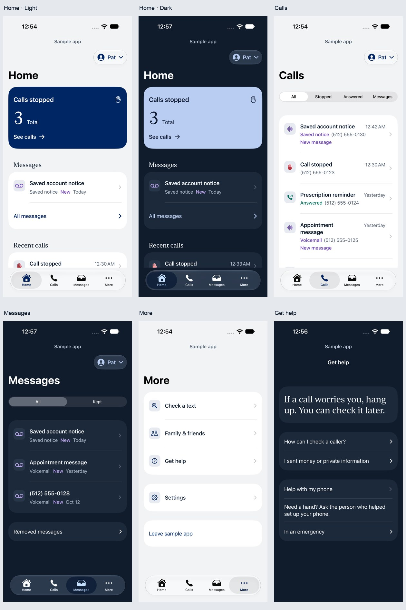
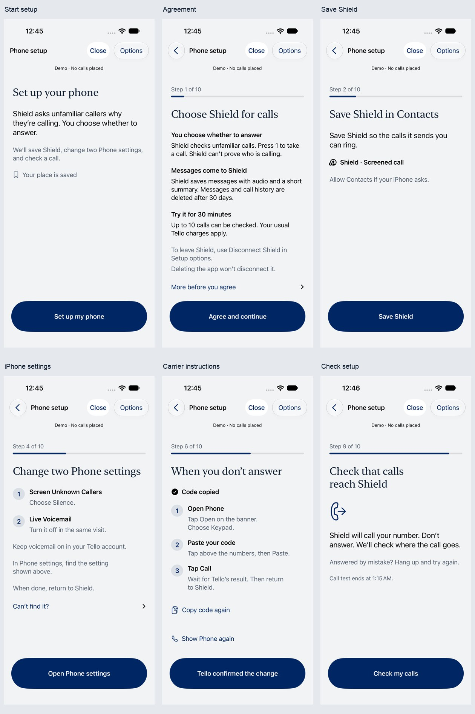

# Shield senior polish: final continuation

October 14, 2026. This continues the [visual polish](IOS-VISUAL-POLISH.md) and [senior walkthrough](IOS-SENIOR-WALKTHROUGH.md). It records local app changes and synthetic simulator verification. Deployment and real-call evidence remain in [Status](STATUS.md).

**Later follow-up:** [The gesture and recovery review](IOS-SENIOR-GESTURE-REVIEW.md) records additional keyboard, large-text filter and step-focus fixes, a continuous-VoiceOver Device Hub walkthrough, and a standalone native clipping reproduction. It supersedes the gesture-availability limitation below; earlier test results remain historical evidence.

## Barriers addressed

The review used the questions “What is this telling me?”, “What should I do next?”, “Can I reach it?”, and “Did my choice disappear?” across the app's light, dark, large-text and failure states.

| Senior-user bottleneck | Resulting behavior |
| --- | --- |
| A spoken history row sounds like a paragraph rather than a control. | The native navigation control owns a short title, outcome/new state, full date and opening hint. Native button traits remain intact. |
| “All calls” and “All messages” look like stray text, and only their words seem tappable. | Each is a full-width, naturally padded action with a decorative chevron, explicit name and at least a 52-point target. Right-edge activation is tested at ordinary and maximum text sizes. |
| “Call checks are off” contradicts the continuously enabled service after a short test expires. | Fresh, prepared, verified continuous-screening status reads “Call checks are on”, with quiet-hour and daily-limit qualifications. Disabled, paused, restoring and stale cases keep their own explanations. |
| An invitation's next action skips its sharing explanation when read aloud. | At accessibility text sizes or with VoiceOver, **Accept invitation** follows the explanation in the reading flow. Ordinary-size screens retain the visible bottom action. |
| A long code consumes the screen, and an error gives no obvious way back. | A native single-line field scrolls horizontally without losing the code. It supports Done and immediate keyboard dismissal on scrolling, retains its value, and provides **Finish editing code** and **Edit code**. An incomplete code has a short explanation. |
| A helper's name field leaves an unclear path to the sharing choice. | **Finish editing name** exits entry and requests spoken focus on **Include messages**. Cancellation preserves the name and existing grant. |
| A playback metadata error hides Pause or makes an ordinary listener think playback failed. | “You can listen. It may still show as new.” explains the effect. At large text sizes and with VoiceOver the warning and playback action stay together. **Mark as listened** names the recovery action. Playback, permission and background guards remain in place. |
| Consent's exit warning is one long spoken block. | Disconnect instructions and the consequence of deleting the app are separate reading units, with the same substantive warning. |
| An additional app clip obscures native list content. | The redundant shared `.clipped()` modifier is removed. Native list scrolling and clipping remain authoritative. |

No fixed-height paragraph or smaller accessibility font was introduced to make a screenshot fit. A history row can exceed the viewport on a 375-by-667-point phone at maximum text size; it scrolls, and a visible area at least 52 points tall can open it.

## Visual review

The final sweep inspected all 48 standard light/dark captures from the surface matrix, the 27 broad-audit captures, and selected maximum-text and error states. The app keeps a quiet neutral/navy palette, serif purpose headings, familiar native controls, generous reading space and explicit action wording. The walkthrough covers the ten app-owned phone-setup steps. Long instructions remain scrollable at maximum text size.

These are compositions of actual synthetic simulator screenshots. Their source capture hashes are in the [capture manifest](../.impeccable/review/voiceover-continuation/curated-captures.json). They are examples of the reviewed screens, not a guarantee of every future data state.

## Verification and limits

The [verification ledger](../.impeccable/review/voiceover-continuation/test-evidence.json) records individual results and failed earlier attempts. It deliberately does not combine corrected reruns into a fictional clean suite.

- Repository typecheck, unit tests and build passed: **231 tests**. The separate required Firestore-emulator run passed **159 tests**.
- The broad iOS 27 functional/visual run passed **15 of 16 methods**, including the guided setup journey, all nine Home service states, the screen matrix, large-text secondary routes and playback recovery. Its number, invitation and quiet-hours recovery method then passed in final focused runs on both iOS 27 Pro and iOS 26.5 SE after correcting native keyboard submission in the test driver.
- All **12 VoiceOver task methods** have a passing run across the corrected sequence. They cover sign-in and email return, native toggle state, onboarding choices and failed save, daily navigation, sharing cancellation, contact-removal cancellation, invitation correction, quiet-hours failed save, playback recovery, and consent/disconnection instructions.
- The iOS 27 broad raw audit retained **six contrast reports**, with **zero text-clipping, hit-region or missing-description reports** in its tested captures. Five of six methods passed; the everyday method remained failed. The six associated targets are partially visible or occluded at native list boundaries. Fully exposed Home/Calls captures pass. This is evidence of a scroll-boundary association, not an exemption or a certified framework cause.
- The iOS 26.5 small-phone everyday audit retained **five contrast and two clipping reports**. One clipping report names **All calls**; one has no associated element. The same action passes ordinary/maximum-text right-edge activation, and the removed-message reading flow passes at maximum text size on this small phone. Those functional passes do not clear the raw audit or establish the unlocalized report's cause. Native footer and actual call/message navigation-row isolation methods passed on iOS 26.5.

The VoiceOver tests enable the actual iOS 27 VoiceOver service and read its focused speech. The simulator could not reliably activate even an app-free native switch with physical-style VoiceOver gestures. The helper therefore records each ordinary tap or page scroll performed with VoiceOver temporarily disabled, then re-enables it to inspect the resulting spoken focus. **This verifies spoken reachability plus ordinary control behavior, not physical double-tap or three-finger gesture operation.** The recorded utterance API also has a limited excerpt length; it cannot certify every complete spoken sentence.

No older participant or physical iPhone was involved. The app-owned setup journey was exercised; external Settings/Phone/carrier handoffs and all ten setup steps with physical VoiceOver gestures were not certified. No owner phone, carrier setting, live call, real recording or production deployment was used for this continuation. Remaining raw runtime diagnostics stay visible in the ledger and do not count as resolved simply because screenshots look readable.
