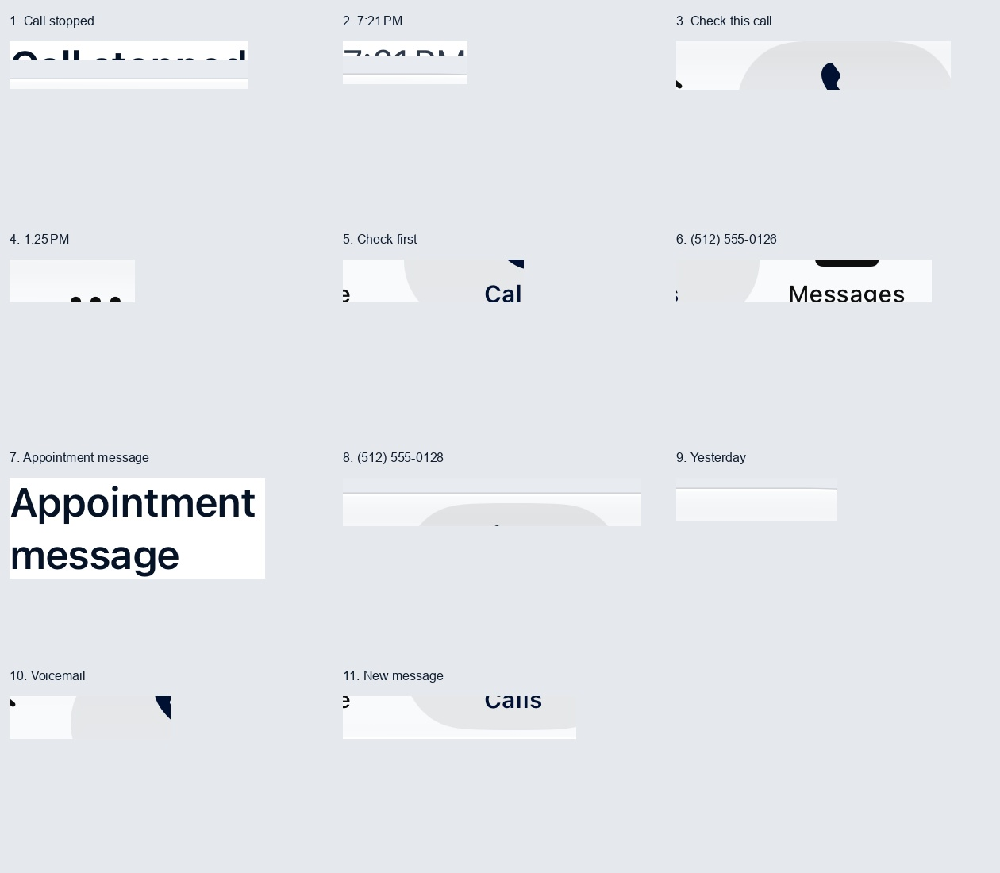
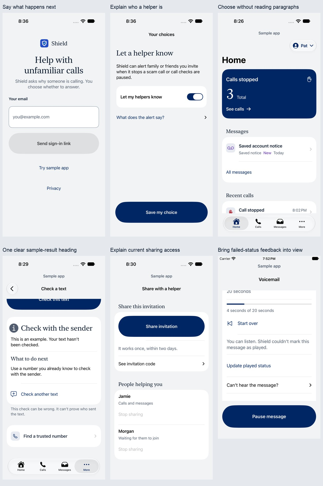
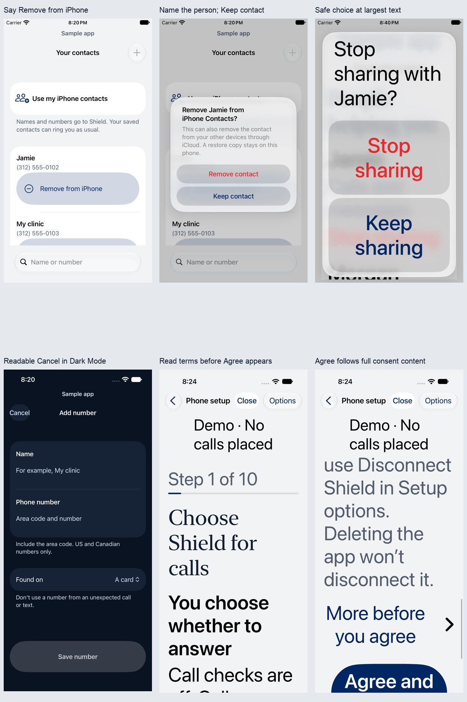

# Shield senior walkthrough and accessibility follow-up

October 13, 2026. The owner asked to address the twenty retained diagnostics and to review the actual experience, including too much reading, unclear instructions and uncertainty about the next action. This continues the visual redesign without replacing its native navy/neutral/serif system.

## How the walkthrough was framed

The working perspective is an older adult with limited familiarity with the app, larger text, less precise tapping and a need to recover without remembering several screens. These are design scenarios, not a claim that all seniors have those characteristics or that a real participant was tested.

For each task, ask: What am I looking at? What do I need to do? What happens when I tap this? What must I remember when I leave the app? Can I recover safely? Required consent, privacy, carrier instructions and uncertainty stay available; decorative or repeated reading should not compete with the task.

| Area | Senior's question or bottleneck | Change or retained safeguard |
| --- | --- | --- |
| Sign-in | “Continue to what? Will this send something or sign me in?” | The action says Send sign-in link or Send email code. The redundant sentence below it is removed. Entered email, validation, Done and retry remain. |
| Email return | “Where did the app go, and what do I open?” | The sent screen names the full destination email and says to open email on this iPhone and tap Shield's link; Resend and Change email remain visible. No button pretends it can open an arbitrary email inbox. |
| Call-protection choice | “What is Shield reading, and can it stop my conversation?” | Shorter wording explicitly says both people's words and retains warnings about ending calls, missed scams and ordinary calls. Provider/deletion details remain in context. |
| Helper choice | “Who are my helpers?” | The explanation names family or friends the person invites, rather than relying on an unexplained role. |
| Large-text choices | “I see Next. Have I missed something?” | Completion continues to follow the full choice in scrolling order at accessibility sizes. Back and failed saves retain both choices. |
| Home and inbox | “Which message should I open? There is a lot to read before I can choose.” | Purpose, message state and date lead each row. Paragraph previews are removed from the lists; opening the message exposes its full summary and listening action. |
| Message detail | “Should I trust this account notice or call its number?” | Full summaries, uncertainty and independently sourced contact guidance remain. A checked caller is not described as verified. Playback, deletion and permission states remain explicit. |
| Home count | “Does this number mean my phone is protected now?” | Current phone status stays before the historical total. Total, zero, unavailable data and retained recent history remain distinct; the count never supplies an active-protection claim. |
| Contact removal | “Does Remove just remove this person from Shield?” | The visible action says Remove from iPhone. The confirmation names the selected contact, explains iPhone Contacts, iCloud effects and the local restore copy, and visibly offers Keep contact. The duplicate swipe shortcut is removed; the visible full-row action remains. |
| Sharing | “Who is this name for, and what can they see right now?” | The field says Your helper's name. Supporting text follows the selected scope: call history without messages, or calls plus reading/listening to messages. Explicit sharing confirmation and ownership limits remain. |
| Scrolling | “Why are the words getting faint near the controls?” | Native scroll fading is removed and the list is clipped to its visible scroll area. Text must not depend on a translucent toolbar for its readable background. |
| Cancel/Close | “Can I tap this without hitting something beside it?” | The actions have complete labels, opaque surfaces and at least 44-point height/52-point width. The native shared translucent background is disabled for these custom toolbar actions; the initial Dark Mode rendering was measured below 4.5:1 and corrected. |
| Safe cancellation | “Which person am I changing? How do I back out?” | Consequential confirmations use native alerts with a visible safe choice. Sharing and contact/saved-number removal name the selected person or entry; action scope and existing consent remain. |
| Played-state warning | “Is my message broken? I don’t see any explanation.” | Failed played-status feedback scrolls into view and receives accessibility focus while Pause/Resume stay available. |
| Setup agreement at large text | “I see Agree. Have I missed the costs or how to leave?” | At accessibility sizes, Agree and continue follows the entire forwarding-consent content and disclosure. Standard-size placement remains. |
| Text-check sample | “Why are there two headings to read?” | Remove the duplicate Sample answer eyebrow; keep the explicit example/not-checked disclaimer and the action heading. |
| Spoken call/message rows | “Why do I have to visit each small piece?” | One action describes purpose, state, number where shown and complete date. Redundant full spoken dates on short hidden child time/date labels are removed; full-row dates remain. |
| Phone setup | “What do I do in Phone, and how do I get back?” | Numbered handoff instructions, copied-code recovery, saved place, Back/Close and individual carrier/settings confirmations remain. Returning to Shield does not certify a change. |
| Errors and empty states | “Did I lose my choice, or is there really nothing here?” | Loading, failed, stale, empty and unavailable states remain separate. Visible recovery retains entered data and never converts a failed read into a successful save or empty list. |

## Diagnostic ledger

The original twenty reports are retained in `.impeccable/review/visual-redesign/final/native-issues.txt`. A fresh unfiltered baseline produced twenty-one reports because a different call-time label was partially exposed near a native bar. Each audit now saves the detailed explanation and complete accessibility tree; no issue-handler exemption was added.

| Original reports | Area and issue | Investigation / correction |
| --- | --- | --- |
| D01–D02 | Home contrast | Fresh evidence localizes call title/time text near the bottom bar. Fading is removed and the visible list has explicit bounds. Retained native reports are classified from diagnostic crops below. |
| D03, D05 | Home unlocalized clipping | The complete date moves to the single row description; isolated actual rows now pass. The post-scroll unlocalized report remains separately documented below. |
| D04, D06 | Home summary clipping, initial and exposed | Remove the paragraph preview from the list while retaining the full summary in detail. |
| D07–D10 | Calls contrast | Fresh evidence localizes the partially exposed call title, time, outcome and number near the bottom bar. |
| D11–D12 | Calls unlocalized clipping | Remove the redundant complete-date child label while preserving the complete row description; normal and accessibility-size layouts stay native. |
| D13 | Removed messages contrast | The reported target is near the bottom bar; verify its fully exposed view and corrected scroll boundary. |
| D14 | Messages unlocalized clipping | Remove the redundant complete-date child label while preserving the complete row description; isolated actual message row passes. |
| D15, D18 | Add-number / invitation Cancel contrast | Complete opaque toolbar controls, explicit minimum targets and hidden shared glass background. Both appearances receive the raw four-type audit. |
| D16–D17 | Contacts hit area | A 52-point full-width action passes enabled synthetic edge taps; the redundant swipe action is removed. Explicit Keep contact is visible and cancellation preserves the entry. |
| D19–D20 | Setup / restoration Close contrast | Both use the corrected opaque toolbar and retain Close/Back behavior; both appearances receive the raw four-type audit. |

The first correction run retained twenty-seven reports and exposed a toolbar-label sizing regression, which was corrected before delivery. Intermediate failures remain evidence. A clean automated result, if achieved, still cannot certify comprehension: [Apple describes these audits as checks for common issues on a particular screen](https://developer.apple.com/documentation/accessibility/performing-accessibility-audits-for-your-app).

## Final diagnostic evidence

The current daily-screen audit **still fails with twelve reports: eleven contrast reports and one unlocalized post-scroll Home text-clipping report**. The four enabled audit types and issue handler remain unchanged; every issue returns `false`. There are no exemptions or hidden failures. These twelve are the current run's reports, not a one-to-one count of surviving original identifiers.

All eleven contrast reports have an associated diagnostic crop, rather than relying on a screenshot taken before the audit moves the screen. Two show text partly exposed at the opaque scroll boundary. Eight show no target lettering because the target is fully occluded. The remaining crop shows the complete “Appointment message” text: ink RGB `(6, 19, 38)` on white measures **18.60:1**. That is a candidate false positive; the raw failure remains recorded. A plain native TabView, NavigationStack and List also reproduces three under-bar contrast reports without Shield styling. This evidence does not certify every report as a framework defect.

The clipping report has no associated element. Actual isolated call and message rows pass after the spoken-date correction. The fully visible stopped-call card has no clipping report; after scrolling, a minimal control containing the actual Shield stopped-call card and otherwise plain native rows produces six unlocalized clipping reports. This supports an unlocalized post-scroll audit problem in the minimal card/list control, **not an app-free reproduction or a certified cause**. No visible text loss was localized in the corresponding current Home capture. The raw signal stays open rather than being declared fixed.

The original summary-clipping, contact-target and toolbar-action problems are corrected in source. Contacts have a reachable full-row removal action and visible Keep contact; exposed call/message rows retain complete spoken dates; the owner settings, onboarding, welcome/email-return and phone setup/restoration audits pass. Corrected Dark Mode Cancel/Close controls also pass the raw audit.

The [raw twelve-report record](../.impeccable/review/senior-followup/verdict/native-issues.txt), [crop classification](../.impeccable/review/senior-followup/verdict/contrast-evidence.json) and [exact exposed contrast target](../.impeccable/review/senior-followup/verdict/diagnostic-exposed-target.png) preserve the evidence and its limits.

## Walkthrough verification

The final Pro simulator run passed all 22 forwarding, Home-readability and senior-design tests and produced 109 named captures across everyday pages, secondary pages, onboarding, setup and recovery in light, dark and largest-text states. The independent review initially found three material barriers—Dark Mode toolbar contrast, Agree appearing before accessibility-size consent reading, and a redundant sample-result heading. Each was corrected and recaptured.

The compact 375 × 667 simulator verifies contact edge taps and cancellation, leaving the sample app with visible Cancel, and named sharing confirmations with Not now / Keep sharing at standard and maximum accessibility text sizes. It also verifies retained input after a failed number save, retained unsaved quiet-hours choices, visible played-status feedback with Pause/Resume still usable, and reachable actions on nine secondary routes at maximum text size. Intermediate test-selector failures remain in the run history; the corrected cases passed separately.

The final unsigned iOS Release build passed. `npm run check` passed the typecheck, 203 tests and build; 153 emulator-dependent tests were skipped there and tested separately. The required `npm run test:firebase` passed all eight files and 154 tests on an isolated local demo emulator. Nineteen core iOS flow tests also passed; the daily audit failure is reported separately above. Detailed runs and source hashes are retained in the [verification record](../.impeccable/review/senior-followup/verdict/test-evidence.json).

The [fresh independent finish review](../.impeccable/review/senior-followup/independent-finish-review.md) records `disposition: ship` for the reviewed source and simulator viewports, with no remaining material barrier established in those captures. It explicitly retains the twelve raw failures and unresolved Home-report cause. This is approval of the reviewed corrections, not a clean-audit or all-users certification.

Only the installed iOS 27 simulator runtime was available, while the app's minimum deployment is iOS 26. No real senior participant, physical VoiceOver session, carrier setting, owner-phone installation, live service deployment or call is part of this follow-up. This walkthrough addresses the observed comprehension and interaction barriers; it cannot establish that every possible senior-user barrier is absent.

## October 14 continuation

The [final senior continuation](IOS-SENIOR-FINISH.md) supersedes this report’s runtime availability and remaining-diagnostic counts. It adds an iOS 26.5 minimum-version pass, twelve actual VoiceOver spoken-focus task methods across corrected runs, native control-owned descriptions, clearer invitation correction and playback recovery, and continuous-screening status. The [new ledger](../.impeccable/review/voiceover-continuation/test-evidence.json) preserves failed attempts and remaining raw diagnostics. It does not certify hardware VoiceOver gestures or older-participant usability.
