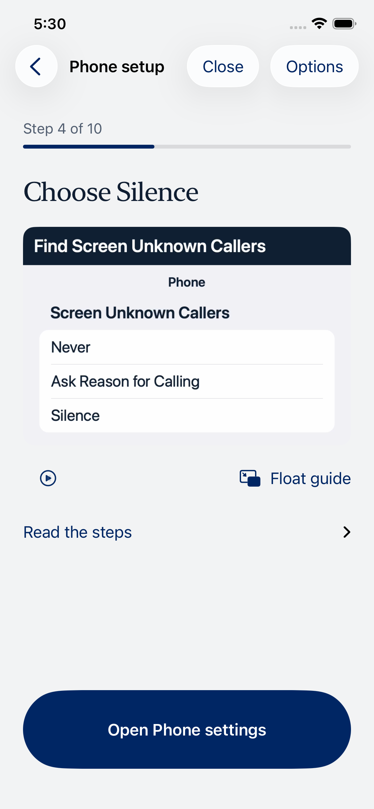
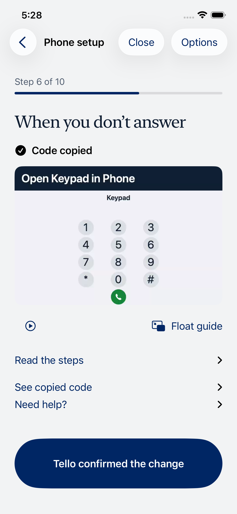
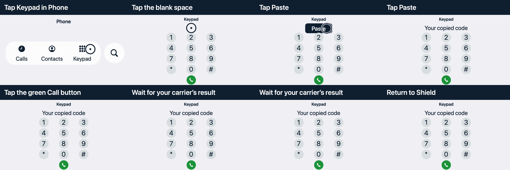
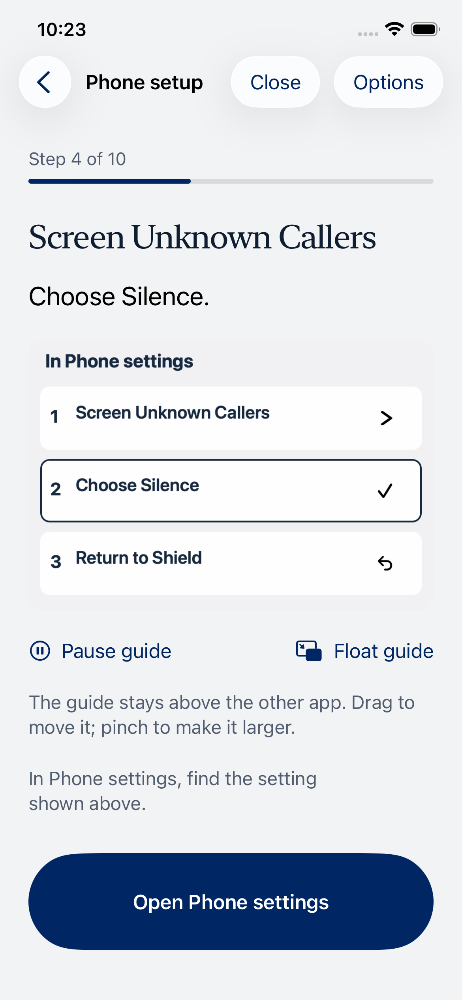
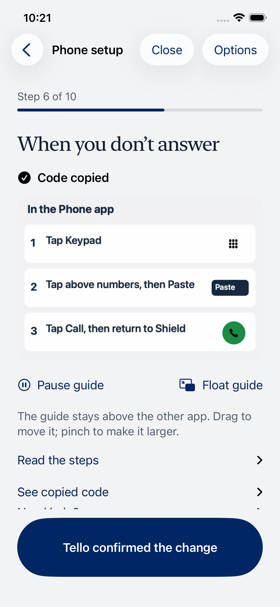

# Floating setup guides

Implementation revised October 15, 2026 after the owner’s screenshot established that the public CallKit shortcut first opens **Call Blocking & Identification**. Earlier claims that its first page was Phone near Call Filtering were mistaken: those captures showed the parent page after navigation. The owner rejected a back-arrow workaround. That approach is removed.

Shield now makes a best-effort direct handoff to the **top of Phone settings**, with no identification-page detour. The authored GIF shows an upward finger gesture on recognizable close-ups: the access rows, the Incoming Calls / Announce Calls landmark, then the exact caller choice or Live Voicemail switch. These are excerpts, not a promise that two swipes reach the target. The stable floating reminder repeats the direction, landmark, stopping heading and action. It does not advance on a timer. Written help includes overshoot recovery and the manual Settings → Apps → Phone route.

The direct Phone URL (`App-prefs:com.apple.mobilephone`) is undocumented. It is a pilot convenience, not an Apple-supported exact-section API or a claim of App Store acceptance. URL acceptance alone cannot prove its landing. Section fragments/path variants and Settings Search links tested from Shield did not reach the requested section. If the link is rejected, Shield stays in the app, stops PiP and presents the manual route; it never substitutes CallKit’s unrelated page. An accepted URL may behave differently on another OS, so written help also covers an unexpected page.

There are **five original GIFs in the app**, independently of the floating reminder. All GIFs are now **1440×960** (previously 600×400), preserving crisp text at iPhone display scale. No in-app play or float controls were added. Phone retains its native Open banner and automatic floating guide. The original artwork contains no owner screenshots, reference-video pixels, personal numbers, actual codes or fabricated carrier results.

Returning, opening Settings/Phone, copying or watching never confirms a setting or carrier change. Explicit confirmations remain separate for each setting and each carrier code. No phone setting, carrier routing, consent or backend verification flag is changed by this UI.

## October 15 — screen-aware experiment retired

The owner rejected the screen-sharing/recognition approach as too complicated. Its debug route, capture and recognition code, simulator stubs, test fixtures, and screen-capture background mode were removed. The original illustrated guides and automatic PiP remain.

The hardware experiment got through native permission after preparing PiP before opening the picker. The owner confirmed Phone settings opened, but the instruction stayed unchanged. Diagnostics showed ongoing frame delivery and OCR results, with no matching public Settings labels; the cause was not established before the owner ended the experiment. No captured screen images or arbitrary recognized text were saved or sent. Capture stopped at its two-minute limit, and Shield was reopened without the experiment. No phone setting, carrier action, call or backend deployment changed. The prototype must not be described as verified live guidance. Its implementation and earlier synthetic checks remain in Git history.

A simpler route through Apple's built-in “Set Silence Unknown Callers” Shortcuts action is under investigation. Apple documents this action in [What's new in Shortcuts](https://support.apple.com/en-us/101583). The action is present in the iOS 27 simulator catalog and a one-action shortcut was authored there; running it returned “An unknown error occurred.” No Voicemail action appeared in that simulator search. Compatibility with the physical phone's three-choice setting, import/run friction, and a route for Live Voicemail remain unverified. It is not enabled in setup.

Removal validation: the device build succeeded and was installed on the pilot iPhone. The normal setup's primary-action and explicit-confirmation simulator regressions both passed. Required checks passed: 242 unit tests/typecheck/build and 175 Firestore emulator tests. The removal has no backend or carrier change.

## Native Shortcuts import under evaluation

A small debug-only preview (`--uitesting-forwarding --uitesting-shortcut-preview`) now shares an Apple-signed file named **Shield Call Silencing**. The person chooses Shortcuts, then Add Shortcut. Adding it does not run it. The file contains exactly the native `is.workflow.actions.silenceunknowncallers.set` action with the editor's default On parameters; Apple's native file preview was inspected and displays **Turn Silence Unknown Callers On**. It has no network, dialing, recording, contact or forwarding action. The generator is `scripts/generate-setup-shortcut.py`; the `anyone` signing mode validates the authored file through Apple and does not use the contact-sharing mode.

The shorter import route passed a real iOS 27 simulator UI test through the native **Add Shortcut** screen, stopping before Add or Run. Quick Look by itself only previews the file and supplied no Add button, so the preview uses the normal share destination instead. The one-action shortcut returned an unknown error when run in the simulator. Applying it on the physical phone and its mapping to the current three-choice caller setting remain unverified. The preview never runs it automatically, and normal setup/Release do not expose this experimental route. It does not solve Live Voicemail. Nothing has been run or changed on the owner's phone through this approach.

## Assets and playback

Source: `scripts/generate-setup-guides.swift` (original AppKit/Core Graphics artwork; ImageIO GIF export; AVFoundation/ffmpeg silent AAC for PiP). Rebuild with `swift scripts/generate-setup-guides.swift`, then `npm run ios:generate`.

Five 1440×960 GIFs use an authored 24-frame/second timeline (336 frames for settings, 432 for keypad). A separate actor owns ImageIO and fully rasterizes each current frame off the main thread. The native image view allows one in-flight frame, drops obsolete work rather than building a backlog, pauses outside the active scene, and cancels work/invalidates its display clock on dismantling. It does not retain every decoded frame. Reduce Motion displays the final target PNG instead. Written instructions carry all actions for VoiceOver and large text. The separate reminder movies include a clear-corner drag hint and are static two-second, 60-frame loops with silent audio; `-still` compatibility resources contain the same steady card. AVKit has a real mounted source layer behind the GIF, bounded startup/cancellation, and the existing serialized mixing audio session. System skip controls remain disabled. PiP stops on return/navigation/dismissal.

## October 15 validation — direct Phone correction

- Required checks passed: `npm run check` (242 unit tests, typecheck/build; expected skipped emulator tests) and `npm run test:firebase` (175 emulator tests).
- Final iPhone 18 Pro / iOS 27 run: all ten setup/guide cases passed. Compact iPhone 17e / iOS 26.5: all three selected normal/largest-text cases passed. The initial largest-text run failed because a single route paragraph was taller than the viewport; navigation and stopping heading are now separate readable elements, and both devices passed the correction.
- The reviewer rejected the initially mislabeled Reduce Motion capture. A real simulator toggle exposed AVPlayerLayer drawing above the SwiftUI poster. The corrected native poster view displays the final target with no moving hand; separate captures have identical poster pixels. The real simulator setting was restored off. The UI test no longer pretends its launch argument enables Reduce Motion.
- Two post-poster-fix normal guide/confirmation checks passed. The review also found the restore flow’s Open Phone settings action below the visible area while confirmation was pinned. The repeated general paragraph is removed for those tasks, and opening Settings now precedes the demonstration; already-done guidance remains in Read the steps. Both normal-size settings actions passed explicit visibility/order assertions on the main and compact phones; the main-phone largest-text restoration check also passed.
- Signed build/install succeeded. On the actual iPhone 12 Pro Max / iOS 27.2, one tap opened the top of Phone with the steady reminder. Moving only the floating window uncovered the Phone title before any Back tap or page scroll. Returning stopped PiP and kept Choose Silence unconfirmed. The Phone banner also automatically floated the keypad reminder; activating the existing Shield app retained the carrier-result confirmation. No setting was changed, no code was pasted/dialed, and no backend deployment occurred. Earlier strict native-Settings assertions could not read the Mirroring tree and failed; those failures are not counted as passing route tests.
- All twenty signed-bundle assets match source bytes or normalized PNG pixels. The 336-frame Mac decode benchmark averaged 8.47ms, maximum 54.96ms while builds/tests were active. The final decoder fully rasterizes on a separate actor, with one in-flight task and no work backlog. This is not instrumented iPhone frame-time or universal no-stutter evidence.

The independent full scoped review’s sole restore-action finding was fixed and its bounded confirmation returned **ship**; see [review](../.impeccable/review/setup-direct-phone/finish-review.md). Current original artwork, synthetic normal/compact/large-text captures and the media ledger are in [the review packet](../.impeccable/review/setup-direct-phone/route-check.md). Owner and physical system screenshots stay ignored/private. Physical older-iOS routing, a novice-senior usability session and continuous iPhone hitch instrumentation remain unverified.

## Earlier October 15 validation — route conclusion superseded

- Required checks passed: `npm run check` (242 unit tests, typecheck/build) and `npm run test:firebase` (175 emulator tests).
- iPhone 18 Pro / iOS 27: all 21 setup/guide cases passed in one run. The three final copy/fallback/largest-text confirmations also passed, including the new largest-text Settings case. Across these runs all 22 distinct current setup/guide cases passed.
- Small iPhone 17e / iOS 26.5: all seven guide cases passed; both final normal/largest-text Settings confirmations passed. Captures include the largest-text top and scrolled action rather than pretending the entire page fits at once.
- Signed iPhone build/install succeeded. Actual iPhone 12 Pro Max / iOS 27.2 showed the GIF without extra controls, automatic steady PiP above Settings, automatic PiP from the Phone Open banner, and return to the same unconfirmed step. The route conclusion was wrong: the owner’s later first-page screenshot proves the shortcut opens Call Blocking & Identification. Parent-page captures do not establish the initial landing. The final five-line card was inspected on hardware. No switch was changed, and no code was pasted or dialed. Physical copy/no-call safety passed; two native-Settings accessibility tests skipped because Mirroring exposed no system Settings tree.
- All bundled GIF/MP4 bytes match the signed app; optimized PNG poster pixels match after normalization. The longest GIF's complete frame-decode benchmark on the Mac averaged 0.53 ms, maximum 3.59 ms. This is decoding evidence, not a measured iPhone frame-time guarantee. See [media validation](../.impeccable/review/setup-route-guidance/media-validation.json).
- The earlier independent review returned **disposition: ship**, but its route finding is superseded by the owner’s later first-page screenshot. See [review](../.impeccable/review/setup-route-guidance/finish-review.md).

These checks establish the inspected devices, assets and routes. Physical older-iOS navigation, continuous iPhone hitch instrumentation, physical VoiceOver and novice-senior usability remain unverified. No production deployment or real-call validation occurred. The updated Settings preview is open on the installed phone. Earlier dated results below describe superseded implementations.

## October 15 validation — simplified demonstrations

- `npm run check`: 242 unit tests, typecheck and build passed. `npm run test:firebase`: 175 local emulator tests passed.
- iPhone 18 Pro / iOS 27: the initial 22-case run had 20 passes, one hardware-only skip, and one retry failure. The result page kept the video above the carrier prompt and recovery controls. Collapsing that video after return makes the result and retry primary. All four final confirmation tests passed, including return/retry, pause/replay and closing during floating startup. Across these runs all 21 distinct simulator setup/guide/safety cases passed; this is not a clean single full-suite run.
- Small iPhone 17e / iOS 26.5: all eight final tests passed, covering the complete setup flow, carrier return/retry and all six guide cases, including largest text in Dark Mode. Normal-size Settings and keypad captures were inspected. Expanded written help remains scrollable.
- All ten final clips have verified uniformly spaced 30 fps timestamps, expected 660/720/900 frame counts and audio tracks. Their SHA-256 hashes match the signed iPhone app bundle. See the [asset ledger](../.impeccable/review/setup-guide-refinement/media-validation.json).
- A real-phone comparison corrected an inaccurate Live Voicemail detail-page illustration: the current guide shows the inline switch on the Phone settings page, and says to leave an already-correct switch alone. Native Phone navigation was also inspected and the keypad clip now starts with the actual Keypad tab. No setting was changed, and no code was pasted or dialed.
- The independent Impeccable finish reviewer returned **disposition: ship** for the supplied source, storyboards and simulator captures, including the small phone. No material fixes were found. The [scoped record](../.impeccable/review/setup-guide-refinement/finish-review.md) excludes continuous playback, physical label accuracy and actual older-adult usability.

Final physical verification (iPhone 12 Pro Max / iOS 27.2): the signed app build and two physical checks passed (copy does not dial; actual floating guide). The Settings accessibility check skipped while Mirroring supplied no system Settings tree; an earlier unmirrored native-choice check passed. The mirrored Phone page and its inline voicemail switch/caller options were visually inspected without changes. The Phone banner automatically carried the final keypad video above Phone; its native tab scene appeared, skipping controls were absent, the window moved clear of the keypad, and returning stopped PiP and displayed the same unconfirmed carrier-result step. No code was pasted or dialed. Manual-plus-navigation test attempts initially hit the floating window over the next button; the movement reminder was added and the two paths now have separate test cases. Earlier exact-heading and mirrored-system-tree test failures are retained in local test logs, not counted as passing runs.

The corrected voicemail assets also passed all six guide UI tests on iPhone 18 Pro / iOS 27. These checks establish rendered content, native handoffs and retained confirmations. There is no instrumented zero-hitch or older-adult usability claim. The updated Settings preview was reopened on the installed phone.

Synthetic layout captures (the keypad capture precedes the final native-tab artwork correction):

## October 14 validation (original checklist artwork)

- `npm run check`: 242 unit tests, typecheck and build passed. The first sandboxed run failed on the local APNs test socket; the permitted rerun passed.
- `npm run test:firebase`: all 175 emulator tests passed.
- iPhone 18 Pro / iOS 27 simulator: 21 distinct tests passed across the final forwarding, guide, safety and accessibility runs; one physical-device-only Settings test was skipped. Final runs comprise all 14 forwarding cases, the copy-does-not-dial safety case, six guide cases, and the three repeated accessibility regressions. The last regression run passed 16 tests plus one skip; the accessibility confirmation passed all eight tests. Earlier large-text/visibility failures led to the scrolling-action correction and were rerun successfully.
- Small iPhone 17e / iOS 26.5 simulator: Settings and keypad guides rendered correctly in Light Mode. Reduce Motion was switched on in the simulator and the guide stopped moving its tap highlights; written steps exposed full combined labels in the accessibility tree. The setting was restored and the extra simulator shut down. Lossy video decoding causes slight pixel differences between static frames; exact pixel equality is not claimed.
- Physical iPhone 12 Pro Max / iOS 27.2, synthetic fixtures: PiP started before the existing Settings launcher, stayed above Phone settings, looped, and stopped on return to the same unconfirmed step. One tap on the existing Phone banner automatically carried the keypad guide above Phone. Moving the floating window exposed the keypad; the demonstrated tap above the numbers displayed Paste. No code was pasted or dialed. The final floating-state placeholder was inspected on hardware. The signed normal app was installed and returned to a launch without test arguments; a transient process-ID lookup failure immediately after ending PiP was followed by a successful launch and running-process readback.
- All ten MP4 resources have 360 uniformly spaced frames at 30 fps, 12-second duration, and the expected audio track. `AVPlayerLooper` handles repetition. Source-level startup, cancellation, return and cleanup were reviewed; the final signed device build passed.

The hardware handoffs were visually inspected, but Instruments could not resolve the running phone process by name or verified PID. There is no instrumented zero-hitch result and no claim of universal stutter-free playback. Physical VoiceOver navigation, an older adult usability session, and actual carrier changes/calls were not performed. This change was not deployed to Firebase or Cloud Run. No owner phone setting, carrier routing, consent, or backend verification flag was changed.

Screenshots below are synthetic simulator data, never the owner's Phone settings:

Implementation follows [Apple’s custom-player PiP guidance](https://developer.apple.com/documentation/avkit/adopting-picture-in-picture-in-a-custom-player).
