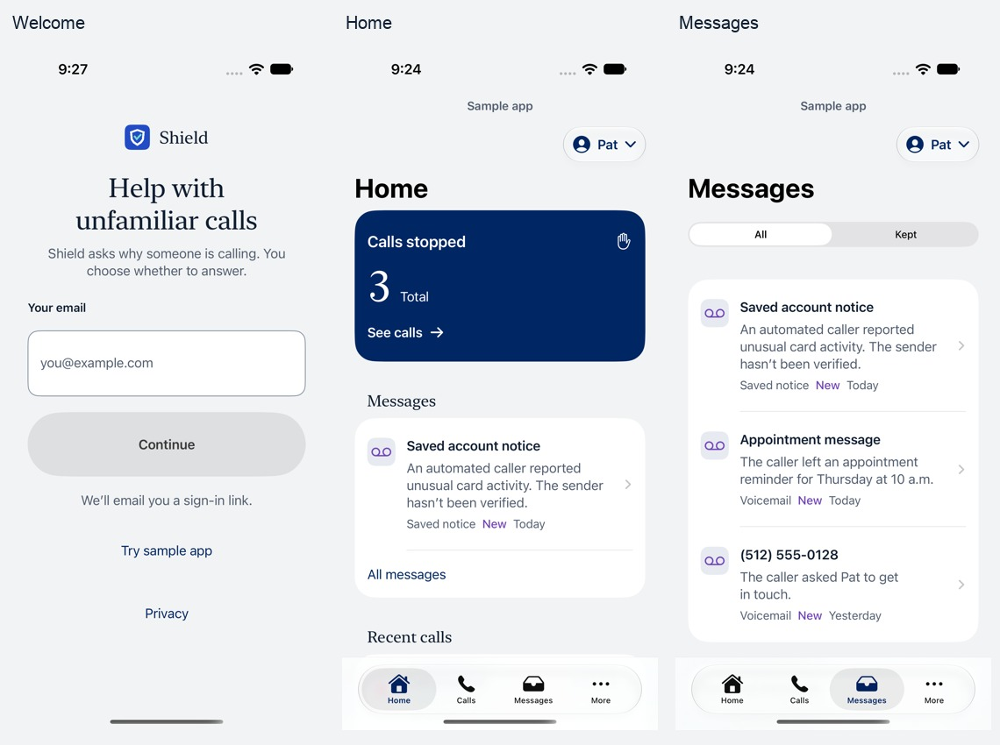
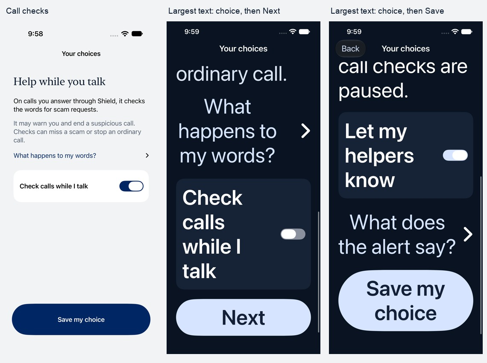

# Shield iPhone visual redesign

October 13, 2026. This replaces the visual presentation of the earlier senior-usability pass; it preserves its functional safeguards and accessibility work. The owner requested a polished design on every screen and named [America.gov](https://america.gov/) as a reference, while putting senior comprehension ahead of fashionable styling.

## Visual direction

The reference was inspected in its live browser rendering. Its serif display type, neutral surfaces and deep navy actions informed this native translation. Shield uses the iPhone’s serif font for onboarding, task headings, call details and section headings, and familiar system sans-serif text for navigation, instructions and controls. No reference-site font, image or government identity was copied into the app.

Light mode uses a pale neutral page, white grouped content and navy actions. Dark mode uses navy page and grouped surfaces, pale blue actions and light text. Stopped, answered and message colors retain their existing meanings and accompany words. Native tabs, navigation, menus, forms, switches, sheets and permission interfaces retain their iPhone behavior.

## Labeled visual and usability bottlenecks

| ID | Observed bottleneck | Implemented correction |
| --- | --- | --- |
| V01 | The welcome’s oversized logo competes with the explanation. | A compact Shield identity precedes one purpose heading and a bounded email form. |
| V02 | Uniform bold system headings give content little hierarchy. | Semantic serif display and section headings distinguish purpose and chapters; instructions and controls remain sans-serif. |
| V03 | Generic surfaces and inconsistent supporting text weaken the visual system. | Named adaptive page, grouped, ink, quiet and field-border colors cover Light, Dark and Increase Contrast. |
| V04 | Forms and custom choice panels diverge in Dark Mode. | A shared native Section wrapper supplies the same adaptive grouped surface without replacing native separators or grouping. |
| V05 | Row icons vary in scale and alignment. | Shared scaled symbol slots align everyday and settings rows; decorative slots disappear at accessibility text sizes. |
| V06 | Unread dots shift only some call rows and depend on color. | A stable icon column and explicit New message text convey the state without moving the text column. |
| V07 | Call and message rows have different visual rhythms. | Consistent leading alignment, spacing, titles and metadata make both histories easier to scan. |
| V08 | A tall historical-total panel crowds the next section at normal text sizes. | Count and Total share a baseline normally; large-text layouts retain a stack and full reading order. |
| V09 | Call details, text-check answers and help lack a clear visual entry point. | A composed serif heading leads each while ordinary instructions remain easy to read. |
| V10 | The custom email outline has insufficient contrast against its field. | Normal outlines now measure at least 3.47:1, with stronger Increase Contrast variants and a navy focused state. |
| V11 | Text-check input actions have an uneven scale. | Native input actions use larger control sizing, clearer text and an explicit minimum layout area. |
| V12 | The invitation field’s faint placeholder disappears after entering a code. | A persistent Invitation code label and opaque paste prompt retain context before and after entry. |
| V13 | New-message text would be repeated through the row’s accessibility value. | Visible state text supplies the combined label once; the duplicate value was removed. |
| V14 | Message dates announce only a relative day to a screen-reader user. | The accessibility label supplies the full date and time. |
| V15 | Initial-account retry uses inconsistent capitalization and fails its existing UI lookup. | Retry wording is consistently Try again; the existing recovery assertion passed unchanged. |
| V16 | A forced navigation appearance hides large titles in the rendered second pass. | The custom UIKit appearance was removed; native automatic bar visibility restores titles and a matching scroll background. |
| V17 | At accessibility text sizes, the fixed onboarding action appears before the selected switch is encountered. | Next and Save my choice follow the explanation and choice in the scroll reading order; standard-size composition, Back and unsaved choices are preserved. |
| V18 | The design guide still describes the rejected palette and typography. | The design record was replaced from the implemented native system, with current evidence and its limits. |

## Coverage and evidence

The source and rendered coverage include welcome and sign-in states; protection and helper choices; Home, call and message histories; call/message details and removal; text checking; family selection, sharing and invitations; account entry; settings, contacts, trusted and blocked numbers, quiet hours, notifications, automatic text checks and help; ten setup tasks and the separate restoration flow. System Phone, Settings, photo picking and permission interfaces retain their native controls.

The independent full review inspected all 48 contact sheets and validated 279 manifest PNGs: 103 on iPhone 18 Pro and 176 on the smaller iPhone 17e, including seven intentional audit-element crops. It returned **fix** for V17 and V18. After correction, the same reviewer inspected all six fresh sheets and 28 recaptures and scored both findings **resolved**, with disposition **ship for those two fixes**. This bounded verdict did not reopen the complete surface review or certify the automated audit. The [full review](../.impeccable/review/visual-redesign/final/finish-review.md) and [scoped verdict](../.impeccable/review/visual-redesign/verdict/finish-verdict.md) preserve their actual scope and missing-input disclosures. The harness used fresh general agents that loaded the shipped Impeccable reviewer/documenter definitions because their custom role names were unavailable.

Intermediate captures under `.impeccable/review/visual-redesign/round-one/` and `confirmation/`, and the pre-correction onboarding views on the full-review contact sheets, are historical evidence. Current onboarding evidence is in `.impeccable/review/visual-redesign/verdict/pro/` and `verdict/small/`.

| Check | Observed result |
| --- | --- |
| Required repository check and final repeat on shared main | Typecheck, 191 unit tests and build passed. |
| First complete synthetic simulator regression | 59 tests passed. |
| Final larger-phone screen/regression matrix | 13 functional tests passed. |
| Final smaller-phone screen/regression matrix | 15 functional tests passed; the separate five-case native audit retained 20 diagnostics in four failed cases. |
| Focused onboarding after the review correction | Nine tests passed on each phone size: normal choices, opt-out, helper-only/combined choices, large-text reading order, Back and repeated failed-save recovery. |
| Corrected Release simulator build | Passed. |
| Required Firestore emulator suite and first isolated repeat | Each passed 153/154; the same ten-simultaneous-participants case failed with `3 INVALID_ARGUMENT: Transaction is invalid or closed`. |
| Final complete isolated Firestore repeat | 154/154 passed with the simulators stopped and a 2 GB emulator heap; all eight test files and their within-test concurrency were retained. |

No test assertion, within-test concurrency, backend retry or repository Firebase configuration was altered for this UI task. The isolated runs used temporary local ports and 60-second test/hook limits. The failures remain evidence even though the final repeat passed.

## Retained accessibility evidence

The native audit is **not clean**. The retained reports include contrast and clipping on Home/Calls/Messages, two unlocalized Contacts hit-area reports, and Cancel/Close contrast. The reviewer inspected those exact toolbar targets: Cancel measured approximately 16.55:1 and Close 20.06:1 in the reported captures. Contacts app-owned action labels retain 52-point frames; the unlocalized reports do not identify an enabled undersized app-owned control, and remain unresolved diagnostic evidence. List summaries intentionally limit excerpts and open full details; content partly beneath native bars was assessed separately from fully exposed rows. No audit filter or exemption was added to manufacture a pass.

The two Dark screenshots are scrolled choice/action viewports on the smaller phone with maximum accessibility text and Increase Contrast. They show completion after the selected choice; they are not initial viewports. The focused recapture packet contains both initial views, Back/off-choice preservation and failed-save/retry recovery on both phones.

All three pre-existing identity PNGs now record their repository origins. Their decoded RGBA hashes remained identical; no new bitmap identity artwork was introduced.

Source and simulator evidence does not establish physical-device, VoiceOver-session, iOS 26 hardware, older-participant or real-call usability. This task does not deploy backend services, install on an owner’s phone, place a call or change carrier settings.
