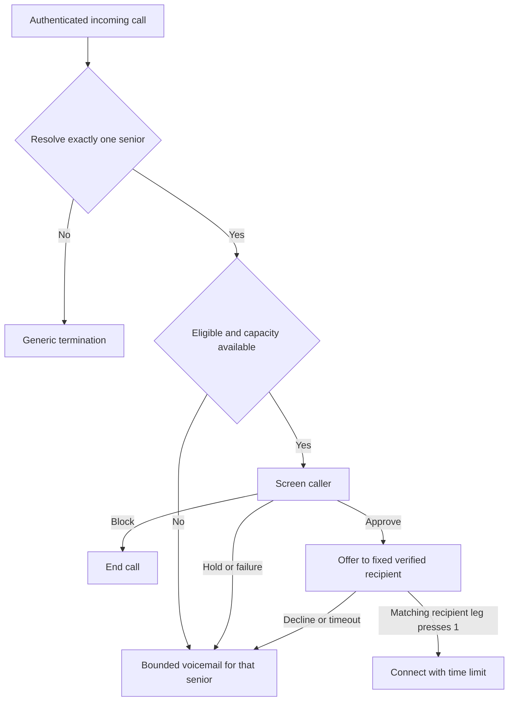

# Scaling Shield to ten seniors

Design revised October 12, 2026. **Proposed, not implemented or deployed.** This revision changes documentation only. The current service remains a supervised single-recipient pilot; deployment and real-call evidence belong in [Status](STATUS.md).

## Recommended decision

Build toward **a small pool of shared forwarding numbers, using each senior's existing phone number as the routing key**. Make a two-line metadata experiment the first milestone, before allocating ten individual numbers. If Verizon and T-Mobile routes qualify, the ten-person pilot can use shared numbers. Dedicated numbers are an exception for incompatible routes, not the default architecture. An optional caller keypad fallback can eliminate even those exceptions, with the caller-experience tradeoffs below.

A rented number is an address, not a physical phone, SIM, dedicated server or single concurrent call slot. Number count and simultaneous call capacity are separate. Telnyx publishes local number rental starting at $1/month; use the contracted rate and actual usage for budgeting. Low pilot rental does not resolve the owner's requirement to move beyond one additional number per senior. [Number pricing, checked October 12](https://telnyx.com/pricing/numbers)

The owner requested Verizon and T-Mobile at minimum on October 12. Qualify those brands directly; do not substitute a Visible test for Verizon or a Tello test for T-Mobile. [Carrier codes and qualification](CARRIERS.md)

Prior decisions recorded October 10 remain planning inputs: around-the-clock screening, phone-guided setup, and participants in the Texas area served by AAACAP. The earlier plan proposed quiet hours of 9 p.m.–8 a.m. Central and also listed that default as needing confirmation; keep it configurable and resolve that default before enrollment. Sponsorship/branding is not authorized by this plan; follow PRODUCT.md.

## How shared-number routing works

For caller C calling senior A, who forwards to Shield number D:

```text
From = C                  identifies the caller, not senior A
To = D                    identifies the Shield destination
Forwarding metadata = A?  may identify A, if preserved and exposed
```

With a dedicated D, the registry resolves `D → A`. With shared D, the registry resolves `(D, forwarding identity A) → A`. The same caller can call A and B concurrently; separate provider call IDs bind each session to its resolved recipient. `From` and `To` alone cannot distinguish them. If forwarding identity is absent, acquire new destination information through an explicit keypad prompt or use a different ingress route. Contact inference, timing and “last active user” are not substitutes. Carrier forwarding cannot be assumed to append an extension or application token.

This architecture has a concrete precedent: YouMail described shared access numbers selected by the carrier's originally called number in 2013. Its 2026 Vonage troubleshooting guide still identifies missing original-called information as a failure mode, with carrier correction or a personal deposit number as remedies. This establishes the approach, not present-day Verizon/T-Mobile-to-Telnyx compatibility. [Historical architecture](https://blog.youmail.com/2013/07/forwarding-calls-to-my-cell-phone/), [current missing-metadata case](https://support.youmail.com/en/articles/13612728-my-calls-are-not-forwarding-to-youmail-when-using-simulring-on-vonage)

Telnyx's official Node SDK exposes optional `call.initiated.payload.sip_headers`, including `Diversion`. This is a concrete Call Control integration path to test, **not evidence that every carrier supplies it or that Shield's TeXML endpoint exposes it**. Current `TelnyxVoice.call()` retains only from/to/status/direction; the inbound handler checks one configured destination. The published TeXML instruction-fetching parameters do not document an equivalent forwarding field. First confirm whether it is available there; otherwise prototype Call Control ingress. Do not assume a Twilio `ForwardedFrom` parameter exists here. [Telnyx SDK schema](https://github.com/team-telnyx/telnyx-node/blob/master/src/resources/webhooks.ts), [TeXML parameters](https://developers.telnyx.com/docs/voice/programmable-voice/texml-instruction-fetching)

An alternative provider has an explicit interface: Bandwidth's inbound `initiate` webhook offers optional `diversion.origTo`. It means the **last** number diverted from, not necessarily the first number called in a forwarding chain. Availability still depends on receiving diversion information. If Telnyx cannot preserve and expose the required data, evaluate a different ingress provider before defaulting every participant to a dedicated number. Provider replacement is an integration project, not a configuration-only fix. [Bandwidth inbound webhook](https://dev.bandwidth.com/docs/voice/programmable-voice/webhooks/initiate/)

A valid Telnyx webhook signature authenticates Telnyx's delivery, not the truth of every upstream SIP header. Shared routing needs a provider-supported trust model for original-called/redirecting numbers, including multiple forwarding hops and caller-injected headers. Successful ordinary test calls alone cannot establish spoof resistance.

| Approach | Assessment |
|---|---|
| Shared inbound pool, qualified redirecting identity | Intended architecture. Establish metadata coverage, provenance, drift detection and safe failure handling before enrollment. |
| Shared number plus caller enters recipient's existing phone number | Optional fallback when metadata is absent. Supplies destination addressing, not authentication; adds friction and may lose automated callers. Can avoid all per-senior extra numbers. |
| Dedicated inbound number, shared backend/capacity | Exception for incompatible routes when the keypad tradeoff is unacceptable; also retain the owner's existing route during migration. |
| Port senior's existing number into Shield | Does not eliminate unique numbers and changes their mobile/SMS/service relationship. Separate product migration, not a pooling shortcut. |
| Deliver accepted calls in-app with VoIP | May reduce the outbound mobile leg and avoid that forwarding loop, but does not solve inbound recipient identification. Separate reliability and accessibility project. |

Use a stable shared Shield caller ID for outbound offers, saved in every participant's contacts and verified during onboarding. It may be one of the pool numbers where provider configuration permits. Inbound callbacks to that shared caller ID get generic handling or the explicitly enabled keypad flow; they do not identify a senior by the caller's identity. Adding or rotating an outbound number requires saved-contact and loop tests.

Inventory becomes `K shared numbers + E dedicated exceptions + test/quarantine stock`, rather than one extra number for each of N seniors. For illustration only, 1,000 seniors with 95% compatible routes and two pool numbers would need 52 active numbers, excluding test/quarantine stock. **95% is an assumption, not measured coverage.** One shared number can serve both carriers if both qualify; separate carrier pools are optional operational boundaries. Additional numbers do not create call capacity or automatic failover: forwarding still targets the number configured at the carrier.

## What must change in the current code

Reviewed against the canonical checkout on October 12; these are code findings, not a fresh production readback.

| Component | Current limitation | Required change |
|---|---|---|
| `backend/src/cloud/config.ts` | One `TELNYX_NUMBER`, `TRIAL_PARTICIPANT_ID`, `TRIAL_VERIFIED_CALLER` | Registry and per-participant verified recipient; retain account credentials centrally. |
| `forwarding-store.ts` | One `forwarding/control`, shared daily usage, fixed participant checks | Per-participant admission/state/usage plus separate global resource limits. |
| `forwarding-voice.ts` / provider adapter | One accepted destination and fixed callback phone | Resolve tenant using dedicated destination or qualified shared-pool identity; preserve routing evidence and freeze assignment on the call. |
| `forwarding-live.ts`, `forwarding-probes.ts`, monitoring/recordings/alerts | Depend directly or indirectly on single-person call/control context | Audit every lookup, callback and job for participant ownership and immutable call binding. |
| `forwarding-api.ts` / iOS setup | Tello response and carrier-specific assumptions | Versioned carrier profiles and verified per-line setup. See carrier guide. |
| `backend/src/live/server.ts` | Process-wide `active` boolean permits one screening | Bounded session map with isolated timers/audio, plus distributed admission. |
| `scripts/deploy-live-bridge.mjs` | One max instance; HTTP request concurrency 4 | Load-tested instance/session capacity. HTTP concurrency 4 does not override the one-session boolean. |
| Test-window and provisioning tools | Owner-only participant/config | Explicit participant selection, audited lifecycle transitions and dry-run preview. |

Do not merely raise Cloud Run's instance count or the current 50-forwarded-calls/day limit. Neither removes tenant assumptions. Preserve the owner's current assigned number during migration.

## Number inventory and allocation algorithm

Separate **inventory**, **assignment**, and **calls**. Suggested records:

| Record | Required information |
|---|---|
| `shieldNumbers/{providerNumberId}` | Destination index, provider application, capabilities, purchase cost, lifecycle state, role (dedicated/shared/test), routing-profile version, membership/load counters, timestamps; exclusive assignment only for dedicated mode |
| `numberAssignments/{id}` | Participant ID, immutable assignment version, number ID, assigned/activated/restored/retired evidence, routing mode |
| `poolRoutes/{poolAndRecipientHash}` | Unique pool/verified-recipient mapping, assignment ID/version, qualification profile, active/tombstoned state; no caller-supplied arbitrary outbound destination |
| `participants/{id}/forwarding/control` | Verified recipient reference/version, carrier-profile version, setup evidence, consent, active/paused/restoring state, quiet hours/timezone |
| `callSessions/{id}` | Participant, assignment ID/version, frozen verified recipient reference/version, inbound provider call ID, child-leg ID, route evidence type, state and deadlines |
| `resourceLeases/{id}` and usage records | Call-owned tenant slot, model slot and outbound slot; expiry/fencing generation; participant and global budget reservations |
| `provisioningOperations/{id}` | Stable request ID, desired state, provider order ID, retry/reconciliation status |

Store private recipient numbers encrypted and index with keyed hashes, consistent with existing vault handling. Public logs and evidence use opaque IDs. Number registry writes are server-only; client-requested participant IDs must pass membership/role checks.

Dedicated-number lifecycle (shared memberships have independent assignment lifecycles):

```text
order_pending → available → reserved → assigned → active
                                      ↘ restoring → quarantine → retired
```

`retired` means no new user can inherit the old route. Releasing a number to the provider is a separate reviewed action. For this pilot, prefer not to recycle an activated number to another senior.

Allocation procedure:

1. Verify enrollment eligibility, recipient ownership, carrier profile and consent prerequisites before buying. Reuse an existing assignment for a retried enrollment request. Choose shared mode when its qualification profile applies; otherwise evaluate alternate ingress, explicitly enabled keypad fallback or a dedicated exception.
2. For shared mode, transactionally reserve membership/load on a compatible active pool and create the unique pool/recipient mapping plus assignment version. Reject duplicate identity mappings and stale qualification profiles. For a dedicated exception or a new pool, reserve compatible `available` inventory. Never take another participant's dedicated number or restoring/quarantined inventory. Prefer a suitable local area code without requiring a vanity area code.
3. If none is available, create one durable order operation. Place the provider order outside the transaction. If the request times out, reconcile the recorded order/provider inventory before ordering again; do not assume it failed. Use provider idempotency only where supported by the exact API.
4. Configure new numbers on the intended provider application/API and read the configuration back. Reused pools must already match the selected routing profile. Only then finalize assignment and expose carrier codes. A failed order/configuration remains pending or quarantined and cannot receive a user's forwarding setup.
5. Run the carrier setup and line tests against that exact assignment. Promote to `active` only when evidence, consent and recipient versions still match.
6. Reconcile inventory daily: provider numbers with no registry entry, registry numbers absent at provider, wrong application, duplicate assignments, stuck orders and unused spares. Alert; never automatically release a number that may receive forwarded calls.

Proposed pilot stock: at most two **never-activated** spares. A separate unsaved test caller number, if needed, is additional inventory and must not be presented as a participant's saved Shield contact. At larger scale, set spare target from expected enrollments during measured provisioning lead time plus a small buffer, bounded by an explicit rental budget. Do not buy one number for every website signup.

## Incoming-call routing and admission algorithm



The diagram summarizes automatic routing; the optional keypad flow below may resolve absent metadata before termination. Full backend/provider outages may prevent voicemail, as specified below. Blocklist and quiet-hour checks remain part of the algorithm.

The following is a specification, not runnable implementation:

```text
on inbound(providerEvent):
  validate signature, timestamp, account/application and event shape
  authenticate provider call lookup; validate direction, destination and state
  obtain stable provider-call deduplication key
  if call already exists: return its state-appropriate, idempotent response

  route = resolveDestination(authenticated destination, forwarding evidence)
  if route is missing solely because forwarding evidence is absent:
    if pool explicitly enables caller addressing:
      collect bounded keypad destination; resolve active enrolled mapping
  if route is missing, conflicting, unassigned or quarantined:
    terminate generically; no user greeting, recording, screening or outbound call

  transaction:
    recheck assignment version, participant eligibility and recipient version
    detect duplicate delivery; reuse existing call if found
    freeze participant + assignment + verified recipient onto new call
    check loop/reentry protection and participant-specific block/trust rules
    if blocked: terminate without model usage
    if trusted, paused, outside permitted schedule, or capacity unavailable:
      choose that participant's bounded voicemail fallback
    else:
      reserve tenant slot + screening slot + estimated spend atomically
      persist SCREENING state and bounded deadlines

  screen call; release model slot when screening ends
  if approved and participant still eligible:
    check quiet hours, current consent and matching recipient/assignment versions
    reserve outbound capacity; transition once to OFFERING
    dial frozen verified recipient using assigned Shield caller ID
    bridge only on digit 1 from the authenticated, matching recipient child leg
  else: use the appropriate hangup/voicemail outcome
  finalize resources exactly once; reconcile uncertain provider outcomes
```

`resolveDestination` for dedicated mode uses the assigned number alone for tenant selection. Caller ID is screening context only. For a call that already exists, later callbacks use its frozen binding, never today's occupant of a number. If the recipient is changed or unverified mid-call, abandon the offer safely rather than dialing the new number.

Duplicate webhooks must not create another model session, recording, child call or budget charge. Provider side effects need durable operation IDs, retry-safe commands where available, and reconciliation on uncertain results. A duplicated callback must not overwrite a later terminal state.

Resource leases need short expirations, renewal, and fencing generations so an old worker cannot resume after losing ownership. Expiry alone does not prove the Telnyx call ended: reconcile/hang up the old leg or let its provider-enforced deadline expire before releasing its outbound capacity. Keep separate screening, ringing and connected-call resources; the AI screening slot should not stay occupied for the entire connected conversation.

**Loop handling:** allow offers only from saved Shield contacts to the fixed recipient. Reject reentered calls from Shield-controlled numbers before screening (an abuse guard, not identity authentication), correlate provider legs where available, allow at most one offer per call, and enforce deadlines. A missed or declined offer must never initiate another offer. Measure each line's no-answer diversion time and keep offer timeout below it with a margin; a 20-second default alone is not proof. Test voicemail pickup and forwarding reentry on Verizon and T-Mobile.

Failure behavior depends on what is known. For a resolved participant with healthy call control/storage, a model failure or capacity refusal uses their bounded voicemail. If recipient identity cannot be resolved, hang up generically without storing someone else's message. If provider/backend failure prevents voicemail, use provider-enforced termination and an operator alert. Never describe an API outage as guaranteed voicemail delivery.

## Capacity and cost controls

Initial target after testing: **ten simultaneous screenings across ten participants**, ten simultaneous recipient offers/connections, and an independent bounded voicemail path. Ten bridged calls can occupy ten inbound and ten outbound legs. Purchasing ten numbers does not establish any of those limits.

Telnyx documents default outbound concurrency of 2, increasing to 10 after Level 2 verification. Inspect this account's actual account/application/profile limits, inbound capacity and calls-per-second allowance before choosing a rollout limit; the documentation is not this account's configuration. [Telnyx concurrency guidance](https://support.telnyx.com/en/articles/1130717-limits-on-concurrent-outbound-calls)

Proposed implementation: test four live sessions per bridge instance, with up to three instances (12 potential model slots) and an application admission ceiling of ten initially. This is a candidate configuration, not a benchmark result. Verify CPU, memory, event-loop delay, audio gaps, model concurrent-session and token/request limits, Firestore contention, function quotas, and monitoring-job backlog. Account for two model services plus connected-call checks; a bridge socket count alone is insufficient.

Use one tenant slot through screening/offer/connection so a second caller for that senior uses voicemail. Other seniors remain eligible. Cap voicemail independently by duration, attempts and storage; routing all excess traffic to unlimited recording would merely move the overload cost.

The old plan's 30 screenings/person/day and 200 global/day are **candidate guardrails**, not a measured $8/day guarantee. At 30 each, all ten cannot receive their full allotment under a 200 global cap. Start with explicit per-person allowances plus a bounded shared reserve, use per-person burst limits, and report which limit caused each refusal. Add a dollar budget with conservative per-call reservations and actual-usage reconciliation. Keep the model-off fallback and warn the operator before exhaustion. Central-time daily buckets must handle daylight-saving changes.

For planning, calculate offered load separately for each resource:

```text
mean screening concurrency = arrivals per second × mean screening seconds
mean outbound concurrency  = approved arrivals per second × mean offer/connection seconds
```

Example assumptions only: 10 seniors × 2 forwarded calls/day × 45 screening seconds = 900 screening-seconds/day, about 0.0104 average concurrent screenings. That small daily average says nothing about a burst of ten calls. Size from measured peak windows and replay 1, 2, 5, 10 simultaneous calls, plus overflow. Do not reduce number inventory when concurrency drops: numbers must remain assigned between calls.

### Monthly cost model

```text
number rental
+ inbound leg minutes × (inbound transport rate + applicable Voice API rate)
+ outbound leg minutes × (outbound transport rate + applicable Voice API rate)
+ streaming minutes × streaming rate
+ recording and transcription usage
+ live-model audio/text tokens + decision/monitoring model tokens
+ compute, database, storage, network, notifications and support
+ carrier passthrough, taxes and any fixed program costs
```

Count inbound time during greeting, screening, holding, connected conversation and voicemail. Count outbound billable time separately, including any answered recipient voicemail. Apply actual billing increments and feature charges from provider records.

Telnyx's published Voice API rate is $0.002/minute **in addition to** inbound/outbound transport, with separate feature charges; TeXML uses the same API fee. Its page currently lists streaming at $0.0035/minute and Soniox transcription at $0.002/minute. These are rate-card inputs, not a total call price or a validated invoice. [Voice pricing](https://telnyx.com/pricing/voice-api)

For an illustrative month of 600 forwarded calls with 45 seconds before outcome, 150 accepted calls averaging 3.5 connected minutes, and 15 seconds of answered offer time each: inbound time is about 1,012.5 minutes before additional voicemail; outbound time about 562.5 minutes. Measure actual streaming/model lifetimes and billable increments rather than pricing 600 calls as 600 single-leg minutes.

Withdraw the earlier $50–60 all-in estimate until a representative invoice and actual live/decision/monitoring usage support it. Do not assume current model use costs a fixed $0.04/call or cloud service stays within free allowances. Record per-senior and p50/p95 per-call cost, support minutes and degraded calls. Around-the-clock availability may add warm-instance and operational costs even if call volume stays flat.

For shared numbers, compare monthly economics:

```text
net saving = dedicated rental avoided - shared-pool rental
             - extra support/operations - amortized engineering/migration cost
```

Use the contracted tier rate for the actual number volume. Sharing also adds migration/revalidation effort and a larger failure impact; approve it only when both reliability gates and economics justify it.

## Shared-number qualification and routing algorithm

The [standalone shared-number test](SHARED-NUMBER-TEST.md) implements the initial metadata/overlap experiment. It does not implement production tenant routing or multi-user screening.

This is the first implementation milestone. Shared routing remains disabled in production until its gates pass; it need not wait for ten dedicated-number enrollments.

1. **Test one shared destination with two known test lines.** Use consenting direct Verizon and direct T-Mobile test lines, both forwarding to one isolated test destination. Compare the independently recorded intended recipient for each test with provider-exposed redirecting information. Capture presence, equality, reason, chain length and opaque call/profile IDs; do not log raw headers, numbers or audio. Begin with diagnostic ingress and generic termination, then test the full offer flow after tenant isolation is implemented. Test setup records establish ground truth; timing is never a production routing key.
2. **Establish provenance.** Obtain Telnyx's documented/support-confirmed meaning, availability and trust guarantees for the selected field on PSTN ingress. Test forged/malformed/multiple headers, direct calls to the pool and forwarding chains. A signed webhook, STIR/SHAKEN caller attestation, or a caller's spoken claim alone is not recipient proof.
3. **Qualify cohorts.** Separate brand/plan/network and device modes. Test no-answer, busy, decline, Silence, powered-off, Wi-Fi Calling, private/international callers, cross-network origins and two seniors called by the same caller. No missing or mismatched identity in the acceptance matrix; more tests increase confidence but do not guarantee every future route.
4. **Assign a stable pool number.** For a qualified participant, choose a compatible pool with the lowest reserved peak load below a validated ceiling; break ties deterministically by participant ID. Shard by validated routing behavior and operational failure boundaries, not merely equal user counts. Store `(poolNumberId, verifiedRedirectingNumberHash) → assignment`. Reject duplicate identity assignments. Shared capacity and number count remain separate.
5. **Resolve every call.** Validate provider ingress, pool membership, approved metadata provenance/chain semantics and exactly one active mapping. Normalize numbers with an explicit country rule; parse structured headers rather than extracting arbitrary digit strings. Reject conflicting/malformed chains instead of guessing the first or last entry. Absent metadata may enter the explicitly enabled keypad flow below; otherwise terminate generically and alert. Never infer the senior from `From`, availability or caller contacts.
6. **Enroll or migrate explicitly.** Configure the pool, save its outgoing caller ID contact, have the participant set carrier forwarding, repeat the line tests, then activate the assignment version. New participants need no interim dedicated number. For existing dedicated users, keep their old number during drain and rollback. An unidentifiable call already arriving on a pool cannot be rescued by looking up a fallback dedicated number because its recipient is unknown.
7. **Detect drift.** Track unresolved/mismatched rates per cohort; one confirmed cross-user route stops new admissions for the affected cohort immediately. Missing evidence marks affected service degraded and triggers support. Changing to a dedicated destination requires carrier reconfiguration and renewed tests, not just a server flag.

The two-line experiment answers the first feasibility question, not a statistical reliability guarantee. Require the full per-line matrix and continued monitoring before expanding. Include concurrent calls from the same external caller to both recipients, no-answer/busy/decline/unreachable, iPhone unknown-call silence, Wi-Fi Calling, withheld caller ID, forwarding chains, direct pool calls and provider retries. Repeat after relevant carrier, plan or provider-route changes. Report correct matches, missing evidence and mismatches separately with denominators.

For a Telnyx Call Control prototype, first confirm field delivery and semantics; then account for the adapter work needed to preserve answer/play/stream, dial, private recipient prompts, leg-specific DTMF acceptance, bridge, voicemail, monitoring and hangup behavior. Map Call Control session/leg IDs deliberately to Shield's immutable session records. Do not assume that changing a webhook URL converts the existing TeXML flow or that the two APIs interoperate without validation. If TeXML exposes the same qualified evidence, retaining it may avoid this migration.

If Telnyx's route loses the information, the next experiment is an ingress provider with an explicit diversion interface, such as Bandwidth, against the same test matrix. An optional field is not a delivery guarantee. Only after those results choose dedicated exceptions, keypad fallback or a narrower supported cohort. No provider changes, number purchases or test calls are authorized merely by this design.

## Optional fallback with no per-senior extra numbers

When a valid inbound call has **absent**, rather than conflicting or malformed, forwarding evidence, an explicitly configured pool may ask: “Please enter the ten-digit phone number you originally called.” This obtains missing destination information from the caller. It does not authenticate them or establish which number was originally dialed; record the route as `caller_selected`, distinct from `carrier_redirected`.

1. Collect keypad input with a proposed maximum of two attempts and 30 seconds total, under a separate bounded pre-routing capacity/rate limit. Do not start the screening model or recording yet.
2. For this U.S. pilot, normalize exactly ten digits to +1 and look up an active, verified participant enrolled on that pool with caller addressing enabled. Never dial the raw input, create a participant from it, reveal an account name or list possible matches. Unknown/inactive destinations receive a generic failure response. Do not use this path to override conflicting metadata or an offboarding tombstone.
3. Freeze that participant's server-stored verified recipient and assignment version, then run ordinary admission and screening. The recipient must still press 1 on their exact offer leg to connect. Entering a number provides no trusted-contact status or permission to skip screening.
4. Apply global pre-routing limits and participant-specific limits after resolution; withheld caller ID cannot bypass limits. A mistyped or maliciously entered enrolled number can select another senior, as with dialing a wrong number. This mode trades automatic destination assurance for caller choice and must be measured separately from carrier-route correctness.

This can support all enrolled users with a shared pool even when metadata is unavailable, **but it cannot guarantee all callers will complete the prompt**. Automated medical reminders and some relatives may abandon or fail it. Measure completion, abandonment and legitimate-offered rates for this mode separately. Default it off until the product explicitly chooses that tradeoff. If zero extra numbers per senior is mandatory, offer this mode or limit support to proven metadata routes; there is no need to pretend a missing destination can be inferred.

## Leaving, pausing and number retirement

A pause stops live screening but does not change carrier forwarding. Keep the number and resolved-user fallback active while restoration is pending.

For a shared pool, offboard **the participant's mapping**, not the entire number. After restoration, tombstone that identity so residual diverted calls cannot reach another participant; disable caller addressing for it too. Keep other members active. Do not attach the same phone identity to a new account without renewed ownership verification and resolution of the old assignment. Quarantine/release a whole pool only after all its memberships have restored and its calls/jobs have drained. The dedicated-number steps below then apply to the pool as a whole.

1. Senior restores the carrier settings using the exact profile and recorded originals.
2. Verify direct ringing, carrier voicemail, and every previously enabled forwarding condition. Record positive restoration evidence.
3. Quarantine the number: no screening, user-specific greetings, voicemail collection or reassignment. Residual traffic gets a generic unavailable response. An arrival means investigate; direct callers and stale forwarding cannot always be distinguished.
4. Proposed minimum observation is 90 days and at least 30 consecutive days without traffic, **in addition to** confirmed restoration, no active calls/jobs and operator review. These timers are not proof that forwarding has stopped. Missing evidence extends quarantine indefinitely.
5. Prefer retirement over reuse within the pilot. Provider release requires an explicit reviewed decision because another party can eventually receive calls to that number. Retain a minimal tombstone/assignment history under the retention policy so stale callbacks cannot target a new user.

At scale, quarantine rental is a real cost. Minimize it through verified offboarding, not blind time-based recycling.

## Rollout and acceptance gates

Implement and validate without changing live forwarding or buying numbers as part of this design task. Production deployment and live settings changes still require owner approval under AGENTS.md.

| Stage | Required evidence before progressing |
|---|---|
| Offline/backend | Tenant isolation, assignment concurrency, duplicate/reordered events, partial provisioning failure, stale assignments, recipient change, consent revocation, loop handling, limits and crash recovery pass. Existing check and Firebase emulator suites pass. |
| Synthetic load | 1/2/5/10 simultaneous tenants and overload; same caller to different seniors; one tenant flood; model/provider failure; instance restart; webhook retry; monitoring backlog. No cross-user data, duplicate offers or false acceptance; all sessions end within deadlines. |
| Carrier qualification | Direct Verizon and direct T-Mobile lines pass the carrier guide, including real unknown-call routing, offer rejection, no-answer and restoration. Identify unsupported conditions explicitly. |
| Two-person canary | After owner-approved deployment, verify the existing owner's route and a consenting test participant, including overlapping calls. No autonomous calls to the owner's phones. |
| Five-person wave | At least 48 hours of stable observed service and required controlled test coverage; no unresolved routing/safety fault. |
| Ten-person wave | At least another 48 hours stable at five, ten-session load gate passed, adequate provider/model limits and documented support/rollback coverage. |
| Pilot evaluation | Review at least a week at ten with actual counts, failure denominators, per-carrier results and cost. Low call volume requires more time; elapsed time alone is not scale evidence. |

Proposed operational targets: zero cross-user routes or unauthorized connections; 100% bounded termination in failure tests; at least 99% of eligible, resolved calls admitted to screening within configured capacity; report overflow separately. Measure carrier diversion delay, Shield-answer-to-greeting, model readiness, screening duration, decision-to-recipient-ring and total caller wait. Investigate p95 total wait above 45 seconds or a material regression from the canary. These are proposed acceptance targets, not achieved performance.

Keep **legitimate-offered** and **harmful-stopped** separate from routing availability. Preserve screening-policy tests and held-out boundaries; no prompt change is part of this scale design. Real calls, synthetic calls and software tests must be reported separately. Observe content-free event timing and failure reasons; never run real recordings/transcripts through evaluation scripts.

Rollback must preserve reachability: if the application is healthy, pause the affected participant/cohort into bounded voicemail. A complete outage needs provider-level fallback/termination plus assisted carrier restoration; the model kill switch alone is not full disaster recovery. Never release numbers as rollback. A cross-user route, acceptance bypass, uncontrolled loop, or unbounded call is an immediate stop condition; isolated model failures use the existing safe fallback and are tracked.

## Implementation order

1. Shared-destination diagnostic prototype and provider field/provenance verification; prepare the two-line Verizon/T-Mobile experiment for owner-approved execution. Compare alternate ingress if necessary before committing to individual-number inventory.
2. Registry and pool membership, immutable call/recipient bindings, per-person authorization and state; isolate all asynchronous jobs and acceptance checks. Implement/regression-test any required provider adapter.
3. Carrier profiles and restoration flows, starting with Verizon and T-Mobile; preserve existing Tello configuration and evidence. Explicitly choose whether to offer the keypad fallback.
4. Idempotent pool/exception allocation and reconciliation, plus a staff setup-status view without transcript or voicemail access.
5. Distributed admission, resource leases, separate model/recipient capacity and measured spending controls; remove the bridge's single-session gate safely.
6. Synthetic reliability/load checks, provider-limit review, full carrier/shared-routing qualification and approved staged deployment. Expand shared membership as evidence permits; track exception count as a scale metric.

Quiet hours remain per senior and apply to Shield offers only. They do not guarantee that every family or urgent caller rings: unfamiliar relatives can still enter screening/quiet hours. Connected-call protection retains current explicit consent and caller disclosure; helpers cannot consent on the senior's behalf. Notifications and supported offboarding must work before always-on enrollment.
